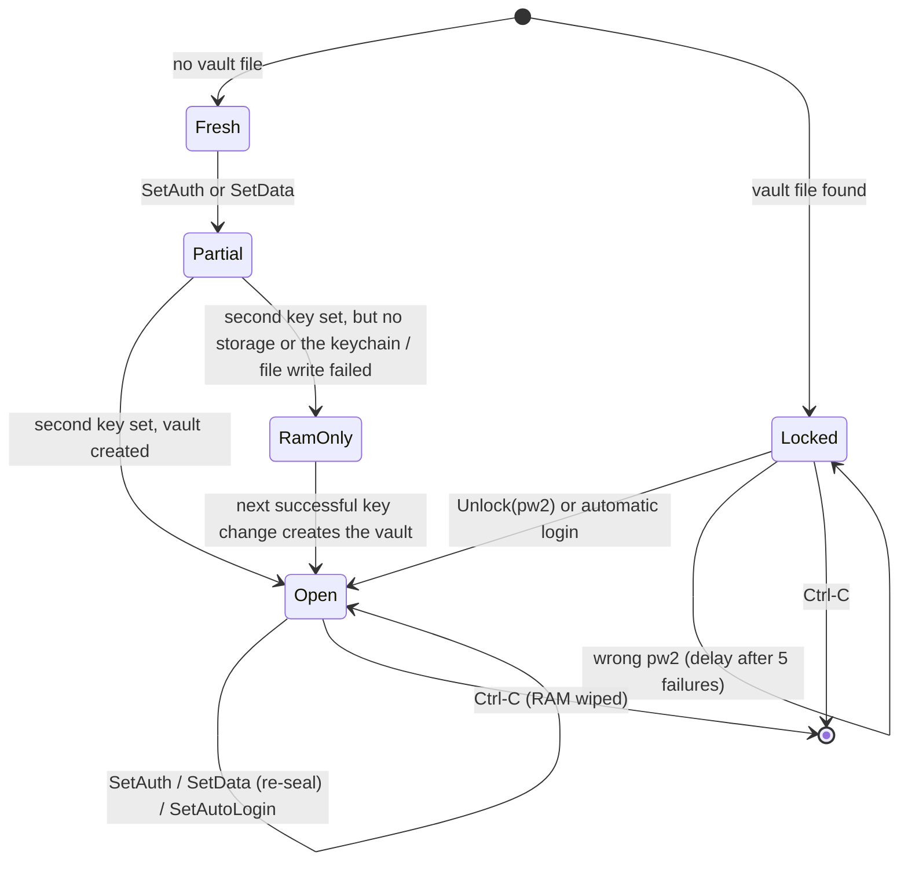

# CesaConn daemon: the complete design

This is the one design document for the daemon (`cesa_conn_networker`) and
for everything security-related that it owns: keys, storage, the UI IPC,
discovery, the `auth_snow` handshake, the transport, pairing, salt sync and
the planned sync features. If code and this file disagree, one of them has a
bug: fix the code or fix this file in the same PR.

It replaces `docs/design/salt-sync-and-clipboard.md`; all of that content
(groups and salt sync, clipboard v1, storage) is in sections 11, 12 and 8.

Every section is marked with its state:

- **[built]**: in `main`, with tests.
- **[planned]**: designed and agreed, no code yet.
- **[open]**: needs a decision before it can be built.

---

## Contents

1. What the daemon is
2. Ground rules (binding)
3. Threat model
4. Secrets inventory
5. Process architecture
6. Lifecycle and state machine
7. Local IPC (UI <-> daemon)
8. Storage: keychain and vault
9. Network layer: discovery, listener, limits
10. `auth_snow`: the handshake
11. Groups and salt sync
12. Clipboard sync (v1)
13. Networking switch and pairing over IPC
14. Rotation, revocation, reset
15. Platforms
16. Logging and error disclosure
17. Verification: tests and the security gate
18. Known weaknesses and limits
19. Decisions log
20. Implementation status and order

---

## 1. What the daemon is

One long-running process per user and device. It is the only place where
keys exist. Every UI (today the TUI, later a GUI) is a thin client that talks
to it over a private local socket.

The daemon **does**:
- derive `a_key` and `d_key` from the passwords (Argon2id) and keep them;
- own every salt, the device identity and the trusted-peer list;
- save its state in the encrypted vault and the OS keychain;
- answer UI requests (status, set password, unlock, automatic login, list peers);
- (planned) run discovery, accept and open connections, authenticate peers
  with `auth_snow`, ask the user to confirm new devices, and move sync data.

The daemon **never**:
- sends a key, a salt or any key-derived secret to a UI;
- writes anything secret to disk unencrypted, configs included;
- puts anything password-derived into a discovery packet;
- trims or otherwise changes a password.

Binary: `cesa_conn_networker`. With no argument, `main` runs `daemon::run()`
(unix only; other platforms log an error and exit). With
`--features test-commands`, the subcommands `servertest` / `clienttest` run
the manual two-machine test instead (section 17). Any other argument is
refused.

Logging: `tracing`, default `cesa_conn=debug` in debug builds and
`cesa_conn=info` in release builds; `RUST_LOG` overrides it.

---

## 2. Ground rules (binding)

These are Czarek's decisions. Every design and every PR must keep them.

1. **Secrets live in exactly three places**: daemon memory (zeroized), the OS
   keychain, or an encrypted file. That covers keys, salts and anything
   derived from them.
2. **The UI holds nothing key-related.** A typed password exists in the UI
   only transiently, in a zeroizing buffer, is handed to the daemon and wiped
   at once. Salts are never shown or kept in the UI.
3. **The daemon owns `a_key` / `d_key`.** No IPC command ever exports key
   bytes. The UI gets status and public peer info only.
4. **Passwords are used exactly as typed.** Never trimmed, never normalised.
5. **Nothing is stored unencrypted**, configs included.
6. **Two independent passwords.** `pw1 -> Argon2id(a_salt) -> a_key` is for
   authentication only; `pw2 -> Argon2id(d_salt) -> d_key` is for data only.
   (Section 18 lists exactly where this independence stops.)
7. **Argon2id is pinned**: v0x13, m = 64 MiB, t = 3, p = 1, 32-byte output.
   The parameters are part of the protocol; changing them changes every key.
8. **SPAKE2 is the only trust decision for the password.** Nothing on the
   wire may be a password-derived value that allows an offline guess.
9. **UDP discovery carries nothing derived from a password or a salt.**
10. **Every feature is off by default**, networking included, also after updates.
11. **Every network read has a timeout, every length from the wire is bounded
    before allocating, every handshake has a deadline.**
12. **No `#[allow(dead_code)]` / `allow(unused*)`.** Unwired code keeps its
    warnings visible.
13. **`#![forbid(unsafe_code)]`** in every crate.
14. **Review loop**: review, fix everything, review again from scratch, until
    a full pass finds nothing. That applies to this document too.

---

## 3. Threat model

### 3.1 Assets

| Asset | Why it matters |
|---|---|
| `pw1` / `a_key` | lets a device join the group and authenticate |
| `pw2` / `d_key` | decrypts all synced data |
| identity seed | lets a device impersonate this device to its paired peers |
| trusted-peer list | decides who is accepted without asking the user |
| synced data (clipboard, later files) | the user's content |
| device linkability | which devices belong together, across networks |

### 3.2 Adversaries and what each one gets

| Adversary | Can | Must not get |
|---|---|---|
| Passive LAN / network observer | see every packet | any key, any (classical) offline password guess, any synced data |
| Active network attacker (MITM, no password) | drop, inject, replay, redirect, flood | anything above; at most a failed connection (DoS) and one online guess per connection, rate limited |
| Attacker who knows `pw1` only | complete SPAKE2 and Noise | trust without the user confirming the pairing code; any synced data (needs `d_key`) |
| Attacker who knows `pw1`, paired by a user who accepted the code | everything a paired device gets | plaintext data without `pw2` (see the offline-guess caveat in 18) |
| Other local user | connect to sockets, read world-readable files | the IPC (uid gate), the vault (0700 dir, 0600 file), keychain items |
| Same-user local process | everything the user can do | **only stopped on macOS signed builds** (code-requirement gate); otherwise out of scope, see 3.3 |
| Thief of the disk / backups | the vault file | contents without `pw2`; on top of that the keychain salts are needed for even an offline guess |
| Quantum attacker recording traffic today ("harvest now") | break X25519 / Ed25519 later | session keys and data (protected by ML-KEM-1024 in the PSK); **not** the SPAKE2 password-guess resistance, see 18 |

### 3.3 Out of scope

- root / kernel / a debugger attached to the daemon: it can read daemon memory.
- An unsigned build on a machine where malware already runs as the user: that
  process can talk to the daemon like the TUI can. Signed releases with
  `CESA_IPC_CODE_REQUIREMENT` close this on macOS (section 7.2).
- The OS clipboard itself: once content is in it, other apps can read it.
- Copies of secrets inside dependencies we can't wipe (section 18).

---

## 4. Secrets inventory

Every secret, how it is made, where it lives and for how long.

| Secret | Made from | Lives in | Lifetime |
|---|---|---|---|
| `pw1`, `pw2` | the user | UI input buffer, then the IPC frame buffers and `PasswordUpdate` on both ends (all `Zeroizing`) | UI: until sent; daemon: until Argon2 finishes; then wiped |
| `a_salt` (32 B) | OS RNG, daemon, first `SetAuthPassword` | daemon RAM; vault | for good |
| `d_salt` (32 B) | OS RNG, daemon, first `SetDataPassword` | daemon RAM; keychain item `salts` | for good |
| storage salt (32 B) | OS RNG, at vault creation | keychain item `salts` | for good |
| `a_key` (32 B) | `Argon2id(pw1, a_salt)` | daemon RAM (`AuthKey`); vault | until pw1 changes |
| `d_key` (32 B) | `Argon2id(pw2, d_salt)` | daemon RAM (`DataKey`) only; keychain item `data-key` only with automatic login | until the daemon stops / pw2 changes |
| KEK (32 B) | `HKDF-BLAKE2s(ikm = d_key, salt = storage salt, info = "cesaconn-storage-v1")` | computed on demand, wiped | one operation |
| DEK (32 B) | OS RNG, at vault creation | daemon RAM while open; on disk only wrapped by the KEK | for good (re-wrapped on pw2 change) |
| identity seed (64 B) | OS RNG, at vault creation: `X25519 private (32) \|\| ML-DSA-87 seed (32)` | daemon RAM; vault | for good: same seed = same device |
| trusted peers | pairing | daemon RAM; vault | until removed |
| SPAKE2 key `key1` | SPAKE2 | handshake task | one handshake |
| hybrid shared secrets | X25519 + ML-KEM-1024 | handshake task | one handshake |
| PSK | HKDF (10.4) | handshake task | one handshake |
| Noise transport keys, handshake hash | Noise | `SecureConnection` | one connection |
| data-layer keys | HKDF(`d_key`, handshake hash, direction label) | computed per message | one message |

Types: keys are newtypes (`AuthKey`, `DataKey`) over `Zeroizing<[u8; 32]>`,
with no `Debug` and no `Copy`, readable only through `expose()`, so `a_key`
can't be passed where `d_key` is expected. `Salts`, `VaultContents` and
`PasswordUpdate` have no `Debug` / `Clone`. Buffers holding secrets are sized
up front so they never reallocate (a reallocation would leave an unwiped copy).

---

## 5. Process architecture

### 5.1 Runtime **[built]**

One tokio multi-thread runtime (`#[tokio::main]`). Blocking work (Argon2, the
keychain, file I/O, the macOS Security framework) always runs in
`spawn_blocking`, never on the async workers.

Tasks today:
- the IPC server (`ipc_server::serve`), one task per UI connection;
- one task per state change (so an IPC deadline can't cancel it halfway).

Tasks once networking starts **[planned]**:
- the TCP listener (`tcp_networker::recv`), one task per connection;
- UDP discovery (announce + listen);
- outgoing connections (`tcp_networker::connect`), one task each;
- the pairing prompt bridge to the UI (section 13).

Shutdown: Ctrl-C cancels a `CancellationToken`; the IPC server stops
accepting, the daemon waits for it and removes its socket file (best effort;
a stale socket is replaced on the next start anyway).

### 5.2 Shared state **[built]**

```text
pub struct Daemon {
    keys: RwLock<KeySlots>,                      // keys, salts, open vault, lock state
    trusted_peers: Arc<RwLock<Vec<TrustedPeer>>>,
    derive_slot: Arc<Semaphore>,                 // 1: one Argon2 run (64 MiB) at a time
    change_slot: Arc<Semaphore>,                 // 1: one state change at a time
    storage: Option<Storage>,                    // None = RAM only
}

struct KeySlots {
    a_key, d_key: Option<AuthKey / DataKey>,
    a_salt, d_salt: Option<Zeroizing<[u8; 32]>>,
    vault: Option<OpenVault>,   // DEK, wrapped DEK, storage salt, config, identity seed
    locked: bool,               // a saved vault exists but isn't open
    auto_login: bool,           // d_key is in the keychain
    unlock_failures: u32,
}
```

### 5.3 Concurrency rules **[built]**

- tokio `RwLock`s only (no `std::sync` locks in the networker). They are not
  re-entrant: never take the same lock twice in one scope.
- **No guard is held across an `.await`.** Values are cloned (zeroizing) under
  the guard and the guard is dropped before any I/O, Argon2 or keychain call.
- **Never hold two locks at once.** The trusted peers are read (and encoded)
  *before* the key lock is taken.
- Check-then-act happens under one write guard (`salt_for`: check and create
  the salt under the same guard).
- **One state change at a time, end to end.** `handle()` waits for the
  `change_slot` *before* spawning, so a waiting request owns no task; once it
  holds the slot, the change runs in its own task and finishes as a whole even
  if the IPC deadline drops the request (never half-saved).
- **One Argon2 at a time.** The `derive_slot` permit moves into the blocking
  task and is released only when Argon2 really finished, even if the caller
  was dropped.
- Saved first, kept second: a key change is written to the vault before it
  replaces the key in RAM, so a failed save changes nothing.

---

## 6. Lifecycle and state machine

### 6.1 States **[built]**



`Status` shows it: `auth_key_set`, `data_key_set`, `locked`, `saved`,
`auto_login`, `network_running` (always `false` until section 13 is built),
`trusted_peers`.

Without storage (Linux and others today, or no safe data directory) the
daemon is RAM only: keys are gone after a restart, `Unlock` and
`SetAutoLogin` answer `NotSaved`, and it logs a warning.

### 6.2 Start **[built]**

1. Build the IPC client policy from the build-time code requirement; refuse
   to start if it doesn't parse.
2. Find and check the socket path, bind it (7.2).
3. Pick storage (`platform_storage()`: macOS only, vault in the private data
   dir, keychain = `OsKeychain`).
4. `start()`: no vault file -> Fresh. A vault file (even an unreadable one) ->
   Locked. Then, if the keychain has a `data-key` item, try automatic login:
   - wrong size: stay locked, warn;
   - it no longer opens the vault: delete it from the keychain, stay locked;
   - success: Open.
5. Serve IPC until Ctrl-C.

### 6.3 First setup **[built]**

1. `SetAuthPassword(pw1)` / `SetDataPassword(pw2)`, in any order. Each is
   refused below 12 characters (`MIN_NEW_PASSWORD_LEN`, counted in Unicode
   characters, bytes if not UTF-8). The salt is made on first use and kept.
2. When both keys exist and no vault does, `create_vault()`:
   1. new storage salt, DEK, identity seed;
   2. `KEK = HKDF(d_key, storage salt)`, wrap the DEK, seal the contents;
   3. write `d_salt || storage salt` to the keychain;
   4. write the vault file atomically;
   5. only then keep the open vault in RAM.
   Any failure: keys stay in RAM only (`saved = false`), nothing half-written;
   the next key change tries again.

### 6.4 Unlock **[built]**

`Unlock(pw2)` (only while Locked; otherwise `BadRequest` if open, `NotSaved`
if there is no vault):
1. inside the unlock delay: refused at once with `UnlockDelayed`, before any
   keychain access or Argon2, and not counted as another guess;
2. read the salts from the keychain (missing or unreadable: `StorageFailed`);
3. `d_key = Argon2id(pw2, d_salt)`, `KEK = HKDF(...)`, open the vault;
4. wrong password = the DEK wrap fails its GCM tag -> `WrongPassword`, the
   counter goes up and the next attempt is refused for `unlock_delay(failures)`:
   the first 5 attempts run back to back, after the 5th wrong password it is
   1 s, doubling to 60 s. A damaged file is `StorageFailed`, never
   `WrongPassword`;
5. success: load `a_key`, `a_salt`, identity, config, peers; counter and
   delay reset.

The delay is a "not before" time, not a sleep: a sleep held the change slot
and outlasted the 10 s IPC deadline from the 10th attempt on, so the UI got a
timeout even for the right password. `Status` reports the seconds left
(`unlock_wait_secs`); the TUI shows them in the status bar and doesn't open
the password field until the wait is over. The guessing rate is the same as
with the sleep: one Argon2 attempt per delay.

The failure counter is in RAM, so a daemon restart resets it. That is
accepted: every attempt still costs a 64 MiB Argon2 run, and a process that
can restart the daemon runs as the user anyway (3.3).

### 6.5 Changing a password **[built]**

The UI asks "are you sure?" before sending a new password for a key that is
already set. The old password is **not** required (his decision).
- New `pw1`: derive with the existing `a_salt`, re-seal the vault with the new `a_key`.
- New `pw2`: derive with the existing `d_salt`, re-wrap the DEK under the new
  KEK, re-seal; with automatic login, replace the keychain `data-key`. If the
  keychain refuses, the old item is deleted and automatic login turns off
  (a stale key must not stay behind).

Until group rotation exists (section 14), a local password change once peers
exist breaks the group. **[planned]**: refuse or warn in that case.

### 6.6 Automatic login **[built]**

Opt-in, after this warning: *"Your data key will be stored in the OS keychain.
Its security then depends on your operating system and account: anyone who can
unlock your user session can use it. We can't vouch for that."* On: `d_key`
goes into the keychain item `data-key`. Off: the item is deleted. Needs an
open, saved vault (`Locked` / `NotSaved` otherwise).

---

## 7. Local IPC (UI <-> daemon)

### 7.1 Transport **[built]**

A Unix domain socket, one request and one response per connection. No XPC,
D-Bus or ALPC (three implementations for little gain).

Socket: `<base>/cesaconn/daemon.sock`
- base = `$XDG_RUNTIME_DIR` (Linux; no fallback, never `/tmp`), or the macOS
  per-user temp dir (`/var/folders/.../T/`);
- the `cesaconn` directory is created `0700` and **re-checked on every use**:
  a real directory (not a symlink), owned by us, no group/other bits;
- the socket itself is `0600`.

Binding: an existing path is removed only if it is a socket owned by us that
nobody listens on. Something else there is `SocketPathTaken`; a live daemon is
`AlreadyRunning`.

### 7.2 Who may talk to whom **[built]**

Daemon side, for every connection, **before reading a byte**:
1. kernel peer credentials: the peer's uid must equal ours;
2. macOS, if built with `CESA_IPC_CODE_REQUIREMENT`: the peer's code signature
   must satisfy it. The peer is looked up by its **audit token** (pid + pid
   version, taken by the kernel at connect time), so a recycled pid or a
   socket handed to another process can't fool the check. It is a dynamic
   check (`check_validity`): the running code must still match its signature.
   Unset: the daemon logs a loud error at start ("IPC CLIENT SIGNATURE CHECK
   DISABLED"). On other platforms a requirement is refused, so it can never
   look like protection that isn't there.

UI side, **before sending a byte** (and so before any password leaves):
1. the directory is still private;
2. the daemon's uid equals ours (`UntrustedDaemon` otherwise);
3. macOS, if built with `CESA_IPC_DAEMON_CODE_REQUIREMENT`: the daemon's
   signature, same audit-token check. Unset: the TUI warns. Set but invalid:
   every daemon is refused (fails closed) and the TUI says why.

Both requirements are only meaningful with a Developer ID signature and the
hardened runtime (otherwise code can be injected). That comes with release
signing **[open: needs his Apple Developer ID]**.

### 7.3 Limits **[built]**

| Limit | Value |
|---|---|
| clients at once | 4 (`MAX_CONCURRENT_CLIENTS`); more are closed at once, not queued |
| time per connection, checks included | 10 s (`REQUEST_DEADLINE`) |
| each read / write | 5 s (`IO_TIMEOUT`) |
| frame body | 1 ..= 72 KiB (`MAX_FRAME_LEN`), checked before allocating |
| password | 1 ..= 1024 bytes (`MAX_PASSWORD_LEN`) |
| peers in `ListPeers` | 256 |
| failed `accept` | 100 ms back-off, no busy loop |

Frames that carry a request are read into `Zeroizing` buffers (a request may
hold a password). Compile-time asserts keep the largest request and the
largest `ListPeers` answer under `MAX_FRAME_LEN`.

### 7.4 Wire format, version 3 **[built]**

```
frame    = length (u32 LE, 1..=MAX_FRAME_LEN) || body
request  = kind (1) || payload
response = 0x00 || payload        (success)
         | 0x01 || error code (1) (error)
```

| Kind | Request | Payload | Success payload |
|---|---|---|---|
| `0x01` | Status | none | `flags (1) \|\| trusted peers (u32 LE) \|\| unlock wait (u16 LE, seconds)` |
| `0x04` | ListPeers | none | `count (u16 LE) \|\| count * (fingerprint (8) \|\| name len (1) \|\| name)` |
| `0x05` | SetAuthPassword | `password` | empty |
| `0x06` | SetDataPassword | `password` | empty |
| `0x07` | Unlock | `password` (the data password) | empty |
| `0x08` | SetAutoLogin | exactly `0x00` or `0x01` | empty |
| `0x02`, `0x03` | retired (v1 sent `salt \|\| password`) | refused, so a mismatched UI and daemon fail loudly | |

Status flags: bit 0 auth key set, 1 data key set, 2 network running, 3 vault
locked, 4 keys saved, 5 automatic login. Any other bit set is `Malformed`.
Unlock wait: seconds until `Unlock` is accepted again (0 = now). Version 2
had no unlock wait; a version 2 status is `Malformed`, so a mismatched UI and
daemon fail loudly.

A fingerprint is the first 8 bytes of the peer's X25519 static public key,
for telling devices apart in the UI; it is not a security check. Names are cut
to 255 bytes on a char boundary.

Error codes: `0x01` BadRequest, `0x02` KeyDerivationFailed, `0x03` Internal,
`0x04` WrongPassword, `0x05` Locked, `0x06` StorageFailed, `0x07` NotSaved,
`0x08` WeakPassword, `0x09` UnlockDelayed.

Decoding is strict: anything not exactly well-formed is refused (`BadRequest`
from the daemon, `Malformed` in the client), and responses are decoded for
the request they answer.

### 7.5 What the UI client must do **[built in the TUI]**

- Hold a typed password only in a zeroizing input buffer, put it into a
  `PasswordUpdate`, send it, and drop the request right after sending.
- Run IPC on its own worker thread (the TUI: one thread with a small
  current-thread tokio runtime), so Argon2 in the daemon never blocks the UI.
- Keep nothing key-related: no keys, no salts, no handshake hashes.
- Show the daemon's warnings (unsigned daemon, invalid requirement) instead of
  hiding them.

### 7.6 Command set policy

The command set grows with the UI; it is not designed up front (his
decision). Planned additions are listed where they are designed: section 11.7
(groups) and 13 (sync switch, pairing prompt).

---

## 8. Storage: keychain and vault

### 8.1 Where each thing is **[built]**

| What | Where |
|---|---|
| `d_key` | daemon RAM only; with automatic login also the keychain |
| `d_salt` + storage salt | the OS keychain (device-only, never synced) |
| `a_key`, `a_salt`, identity seed, trusted peers, config | the vault file, encrypted |

### 8.2 Keychain **[built on macOS]**

Service `dev.czarekk.cesaconn`, two generic-password items:
- `salts`: `d_salt (32) || storage salt (32)`;
- `data-key`: `d_key (32)`, automatic login only.

macOS: the login keychain with synchronisation off (never iCloud). The
data-protection keychain with `WhenUnlockedThisDeviceOnly` needs the
entitlement that comes with release signing **[open]**. Values come back in
`Zeroizing`; the copy inside the Security framework (`CFData`) is released by
the OS and can't be wiped from here. Behind the `SecretStore` trait, so tests
use memory.

### 8.3 Vault file format, version 2 **[built]**

Path: macOS `~/Library/Application Support/cesaconn/vault.bin`, elsewhere
`$XDG_DATA_HOME/cesaconn/vault.bin` or `~/.local/share/cesaconn/vault.bin`
(directory `0700`, checked like the IPC directory).

```
MAGIC "CESAVLT\0" (8) || VERSION 0x02 (1)               header
wrap nonce (12) || AES-256-GCM(KEK, DEK) (32 + 16)       AAD = header || "cesaconn-vault-dek"
data nonce (12) || AES-256-GCM(DEK, plaintext) (n*4096 + 16)  AAD = header || "cesaconn-vault-data"
```

- `plaintext = contents len (u32 LE) || contents || zeros`, padded to whole
  4096-byte blocks, so the size doesn't reveal how many peers or how much
  config there is. Unpadding is strict: every padding byte must be zero.
- `contents` is TLV, `tag (1) || len (u32 LE) || value`, every tag exactly
  once and in this order, nothing after:
  `0x01 a_key (32)`, `0x02 a_salt (32)`, `0x03 config (<= 64 KiB, empty today;
  its inner format comes with the first setting, the Sync switch)`,
  `0x04 identity seed (64)`, `0x05 peers (<= 1 MiB)`.
- peers: `count (u16 LE) || count * (x25519 pub (32) || ML-DSA-87 vk (2592) ||
  name len (u8) || name)`, at most 256 peers, names at most 255 bytes with no
  control characters (no terminal escapes in the TUI), no duplicate keys,
  exact length.
- Every seal uses a fresh random 96-bit nonce under the same DEK (and every
  wrap one under the KEK). A device seals once per change (a password, a new
  peer), far below the ~2^32 encryptions where random GCM nonces get risky.
- The only plaintext on disk is the format metadata: magic, version, nonces,
  ciphertexts. No salt, key, config value or content length.
- Version 1 files are refused (`Malformed`).

Reading: the directory is re-checked; the file must be a regular file of ours
with no group/other bits and at most 4 MiB, checked before reading and bounded
while reading. Writing: a new `0600` temp file with a random name in the same
directory (`create_new`), written, fsynced, renamed over the old file, then
the directory is fsynced; a failed write removes the temp file.

Errors: a failed DEK unwrap is `WrongKey` (the only place a wrong password
shows); a DEK that unwraps but contents that don't decrypt or parse is
`Corrupt`. The daemon maps `WrongKey` to `WrongPassword` and everything else
to `StorageFailed`, with details only in the daemon log.

### 8.4 Known costs **[accepted]**

- Anyone holding the vault file **and** the keychain salts can try data
  passwords offline at Argon2 speed (64 MiB per guess). Hence the 12-character
  minimum; a strength hint in the UI is **[planned]**.
- Cracking `pw2` from the vault also yields `a_key` (it is inside), so at rest
  the two passwords are not independent: see section 18.
- Linux has no keychain backend yet (Secret Service needs a dependency
  decision), so Linux is RAM only and says so. Headless Linux has no Secret
  Service at all.
- A forgotten data password means the vault can't be opened. Reset comes with
  section 14.

---

## 9. Network layer: discovery, listener, limits

### 9.1 Discovery (UDP) **[built, not started by the daemon yet]**

- Port 3636. Announcement = `"CESACONN" (8) || version 0x01 (1) || instance id (16)`,
  25 bytes, sent to `255.255.255.255` once per second.
- The instance id is random per start, only so a device ignores its own
  broadcasts. It is not an identity and not a secret.
- The listener accepts exactly 25-byte packets with the right magic and
  version; one search has one deadline, so junk can't extend it; broadcasts
  and searches are capped at 20 s each.
- **Nothing in an announcement is derived from a password or a salt.** A
  password-derived value (for example AES-GCM of a known name under `a_key`)
  would let anyone on the LAN capture one packet and guess the password
  offline. So the result of discovery is only a hint where to connect: only
  the IP is used, the port is fixed, and trust is decided by the TCP handshake
  alone. Forged or replayed announcements can at most cause a failed connection.

### 9.2 TCP listener **[built, not started by the daemon yet]**

- **[open]** the daemon's TCP port. The test commands use 3232.
- At most 16 unauthenticated connections at once (`MAX_CONCURRENT_CONNECTIONS`);
  a connection over the cap is closed at once, not queued.
- Each connection runs `recv_handler` in its own task, cancelled with the
  daemon's token.

### 9.3 Bluetooth **[open]**

`btleplug` is a dependency of the networker, but no code uses it and there is
no design yet. Until there is, it is attack surface without a feature: either
design it or drop the dependency.

### 9.4 Online guess limiter **[built]**

SPAKE2 allows exactly one password guess per connection, so the remaining
attack on `pw1` is many connections. `guess_limiter` counts failures per
source: one IPv4 address, or one IPv6 /64 (IPv4-mapped IPv6 is treated as
IPv4).

- 5 failures in a row lock the source out for 1 min, doubling with each
  further lockout up to 1 h. A successful handshake resets the source.
- At most 4096 sources tracked; stale ones (not locked, quiet 2 h) are
  dropped first; if it is still full, a new source is not tracked (better
  than locking out everybody new).
- **Server side**: a locked source gets no handshake at all; a wrong client
  confirmation counts as a failure.
- **Client side**: a fake server learns one guess from our confirmation value,
  so servers are counted too, and we don't connect to a locked one. Counted:
  a wrong server confirmation, any failure of the confirmation step
  (`FailedToConfirmMutualAuthSpake2`, which also covers a server that hangs up
  instead of answering), and any `HandshakeTimeout`. The last two also count
  failures that happened before our value was sent; that over-counts on
  purpose rather than miss a guess.
- A peer that disconnects *before* sending its confirmation learned nothing
  (a SPAKE2 transcript alone doesn't allow an offline guess), so it isn't counted.

---

## 10. `auth_snow`: the handshake

`auth_snow` turns a TCP stream into an authenticated, encrypted
`SecureConnection` to a known (or newly confirmed) device. Entry points:
`auth_incoming` (server) and `auth_outgoing` (client); both return
`Ok(Some((SecureConnection, TrustedPeer)))` on success and `Ok(None)` when
the peer failed SPAKE2 (wrong `a_key`).

### 10.1 Overview **[built]**

| Phase | What | Proves / gives |
|---|---|---|
| 1 | SPAKE2 (Ed25519 group) with `a_key` + key confirmation | both know `pw1`; shared `key1` |
| 2 | hybrid KEX: X25519, then ML-KEM-1024 | two fresh shared secrets, one post-quantum |
| 3 | PSK = HKDF(key1, both secrets, transcript hash) | binds everything before Noise together |
| 4 | Noise `XXpsk3_25519_ChaChaPoly_BLAKE2s` with the device's static key | encrypted transport; peer's static key; handshake hash |
| 5 | IsSaved exchange + mutual ML-DSA-87 signatures over the handshake hash | peer owns its identity key; known peers are pinned |
| 6 | pairing confirmation, only if the two don't both know each other | a human approved the new device |

Roles: the client is the TCP initiator, SPAKE2 side A, the Noise initiator,
and sends first wherever both sides send.

```
client                                              server
  |  SPAKE2 msg A (33 + tag)          ---->            |
  |            <----      SPAKE2 msg B (33 + tag)      |
  |  confirm C->S (32)                ---->            |   wrong: close, count guess
  |            <----      confirm S->C (32)            |
  |  X25519 pub (32 + tag)            ---->            |
  |            <----      X25519 pub (32 + tag)        |
  |  confirm byte                     ---->            |
  |  ML-KEM-1024 pub (1568 + tag)     ---->            |
  |            <----      ML-KEM ct (1568 + tag)       |
  |  confirm byte                     ---->            |
  |        (both: PSK = HKDF(...))                     |
  |  Noise msg1  -> e                 ---->            |
  |            <----      Noise msg2  <- e, ee, s, es  |
  |  Noise msg3  -> s, se, psk        ---->            |
  |  ===== Noise transport from here =====             |
  |  IsSaved (1)                      ---->            |
  |            <----      IsSaved (1)                  |
  |  ML-DSA vk (2592), sig (4627)     ---->            |   server verifies first
  |            <----      ML-DSA vk, sig               |
  |  [pairing decisions, if needed]   <--->            |
```

Phases 1-5 run under one deadline, `HANDSHAKE_DEADLINE` = 20 s, so a peer
can't drip one message every 4.9 s and hold a slot for minutes. Pairing waits
for a human, so it runs after the deadline, and only for a peer whose
signature already verified.

### 10.2 Phase 1: SPAKE2 **[built]**

- Crate `spake2`, `Ed25519Group`, password = the 32 bytes of `a_key`,
  identities `"client"` (A) and `"server"` (B) on both sides.
- Each side sends its message (side byte + point = 33 bytes) plus tag `0x01`.
  Both messages, tags included, go into the transcript in the order client,
  server, on both sides. `finish()` checks length and side byte.
- Key confirmation, labels per direction so a value can't be reflected:
  `HKDF-BLAKE2s(ikm = key1).expand("CPQHA-confirm-client-to-server")` and
  `...("CPQHA-confirm-server-to-client")`, 32 bytes each.
- **The client proves first.** The server compares in constant time and only
  then sends its own value; a peer without the password learns nothing from
  the server. A wrong value (on either side) means `Ok(None)` and a counted
  guess (9.4). Both values are appended to the transcript on success.

Why SPAKE2 first: it is the only step that depends on the password, and it
gives an attacker exactly one online guess per connection and nothing to test
offline. Everything later is bound to its result.

### 10.3 Phase 2: hybrid key exchange **[built]**

Pre-Noise messages are plaintext on TCP; their integrity comes from the
transcript being mixed into the PSK (10.4), which only someone who passed
SPAKE2 can compute.

X25519 (fresh ephemeral key per connection, both sides):
1. client -> server: public key (32) + tag `0x01`;
2. server -> client: public key (32) + tag `0x01`;
3. client -> server: confirm `0x01` (or `0x00` if the server sent a low-order
   point) + tag `0x02`.
Both sides refuse a non-contributory (all-zero) shared secret.

ML-KEM-1024 (fresh key pair per connection):
1. client -> server: encapsulation key (1568) + tag `0x03`;
2. the server runs the FIPS 203 key check (`validate_public_key`), encapsulates,
   and sends the ciphertext (1568) + tag `0x03`;
3. client -> server: confirm `0x01` + tag `0x02`.
Decapsulation uses implicit rejection: a tampered ciphertext gives a random
key, which then fails at the Noise PSK step instead of leaking anything here.

Anything other than an explicit `0x01` confirmation is a rejection. Every
message, tags included, goes into the transcript in the same order on both
sides.

### 10.4 Phase 3: PSK **[built]**

```
transcript_hash = HKDF-BLAKE2s(ikm = transcript).expand("")           (32)
psk = HKDF-BLAKE2s(ikm = key1 || x25519_ss || mlkem_ss || transcript_hash)
          .expand("CPQHA-psk")                                         (32)
```

- `key1` binds the KEX to SPAKE2: a MITM that only relays SPAKE2 can't
  derive the PSK.
- `mlkem_ss` makes the session keys post-quantum: breaking X25519 alone isn't
  enough.
- The transcript hash makes any change to a pre-Noise message (a swapped key,
  a stripped confirm byte) a PSK mismatch, caught when Noise message 3 fails.

### 10.5 Phase 4: Noise **[built]**

- `Noise_XXpsk3_25519_ChaChaPoly_BLAKE2s` (crate `snow`), PSK at position 3,
  local static key = the device's X25519 identity key.
- Message sizes are fixed and checked: msg1 48 (e + empty-payload tag),
  msg2 96 (e, encrypted s, tag), msg3 64 (encrypted s, tag). All payloads
  are empty.
- After msg3: the peer's static public key (its identity, looked up in the
  trusted peers) and the 32-byte handshake hash, saved before switching to
  transport mode (snow only exposes it before). Every read and write has the
  5 s `TIMEOUT`.

The server's static key in msg2 is encrypted only under `ee` (the PSK enters
at msg3), so it is visible to whoever completes msg1. That is acceptable
because Noise only starts after SPAKE2 succeeded: only a holder of `pw1`
ever gets there.

### 10.6 Phase 5: identifying the peer **[built]**

Inside the Noise transport. The two steps always run in this order and the
message sequence never depends on what either side knows:

1. **IsSaved**: one byte each, client first (tag `0x05`): "I have you saved".
   `both_saved` is true only if both bytes are `0x01`.
2. **Signatures**: both sides *always* send their ML-DSA-87 verification key
   (2592, tag `0x02`) and a signature over the handshake hash (4627, tag
   `0x03`), client first. Contexts per role: `"CesaConn Client Handshake"` /
   `"CesaConn Server Handshake"`, so one side's signature can't be replayed as
   the other's. Signing is hedged (fresh 32 random bytes).
   - For a known peer, the received key must equal the stored one (constant
     time), otherwise `PeerKeyMismatch`: a device can't swap its identity key.
   - The signature is always verified with the received key, which proves the
     peer holds the private key.
   - **The server verifies the client before sending its own key and signature.**
   - The handshake hash is unique per connection and identical on both sides,
     so a valid signature proves the peer took part in exactly this handshake.

A device is identified by both keys: the X25519 static key (Noise) and the
ML-DSA-87 key (signatures). Both come from the 64-byte identity seed, and the
seed is in the vault, so a restart is the same device and needs no new pairing.

### 10.7 Phase 6: pairing confirmation **[built: protocol; planned: real prompt]**

Runs only if `both_saved` is false (new device, or one side forgot the other):

1. If 256 peers are already saved: refuse *before* asking the user. (That side
   then closes without sending a decision; the other side gives up after its
   wait in step 4.)
2. Ask our user (`pair_fallback(name, handshake_hash)` on a blocking thread,
   at most `PAIRING_TIMEOUT` = 60 s; timeout = reject).
3. Send our decision, **even a rejection**, so the peer doesn't wait for
   nothing: client tag `0x04`, server tag `0x06`.
4. Read the peer's decision, waiting up to 60 + 5 s (its user may still be
   deciding). Only `0x01` is acceptance.
5. Only if both accepted: save the peer (under the write lock, no duplicates,
   cap re-checked) and return the connection.

Today `pair_fallback` is a plain blocking `fn` pointer, and the test commands
show 8 hex bytes of the handshake hash. The real pairing code, decided:
**8 emoji from a fixed 64-entry table (6 bits each, 48 bits), each always
shown together with its name** (the names cover terminals that render emoji
differently or as tofu), derived with HKDF from the handshake hash; `y/n` on
both devices; 60 s timeout = reject. Its delivery through the daemon to the
UI is section 13. **[planned]**

A MITM who knows `pw1` would have two different Noise sessions, so the two
users would see different codes. 48 bits make a lucky match about 1 in 2.8 *
10^14 per attempt.

The peer's display name is its socket address until devices exchange real
names **[open]**.

### 10.8 Timeouts **[built]**

| Name | Value | Covers |
|---|---|---|
| `TIMEOUT` | 5 s | every single read / write, also inside chunked transfers |
| `HANDSHAKE_DEADLINE` | 20 s | phases 1-5 together |
| `PAIRING_TIMEOUT` | 60 s | our user's decision |
| peer decision wait | 65 s | `PAIRING_TIMEOUT + TIMEOUT` |

### 10.9 `SecureConnection` (transport) **[built]**

Only timed, tagged operations are public; the raw stream and the Noise state
are private, so nothing can bypass tags, size limits or timeouts.

- One message = `plaintext || tag byte`, encrypted by Noise (+16 byte tag). No
  length goes on the wire: the receiver must know the exact length, which is
  why every message has a fixed size or a length from an earlier, bounded
  header. At most `SECURE_MSG_MAX_PAYLOAD` = 65535 - 16 - 1 = 65518 bytes.
- `write_timeout` / `read_timeout`: one message, 5 s.
- `write_chunked` / `read_chunked`: any length, split into maximal messages.
  The length must be known out of band and **bounded by the caller**; the
  buffer is allocated once. Noise nonces make chunks impossible to reorder,
  drop or replay unnoticed.
- **`d_key` data layer** (`write_encrypted` / `read_encrypted`), the inner
  layer that keeps data unreadable without `pw2` even if the Noise session
  were broken:
  ```
  key = HKDF-BLAKE2s(ikm = d_key, salt = handshake hash)
            .expand("CPQHA-data-client-to-server" | "CPQHA-data-server-to-client")
  wire = nonce (12) || AES-256-GCM(key, data)       (+16 tag)
  ```
  Per connection (bound to the handshake hash, so a payload can't be replayed
  into another connection) and per direction. `DATA_LAYER_OVERHEAD` = 28 bytes.
  A wrong `d_key` or tampering fails the GCM tag.

### 10.10 Application framing **[built]**

After `auth_snow` the client sends exactly one packet per connection (v1):

1. init header, one message, tag `0x01`, 9 bytes:
   `ActionType (1) || length (u64 LE)`, where length = payload + 28, or 0 for
   no payload;
2. the payload through the `d_key` layer, chunked.

The receiver bounds the length before allocating: at most
`MAX_DATA_PACKET_LEN` (16 MiB) + 28. The sender checks the size *before*
authenticating, so it doesn't pair just to fail afterwards.

| ActionType | Value | Payload |
|---|---|---|
| Default | `0x00` | unknown values fall back to it, so newer peers stay compatible |
| Debug | `0x01` | test only |
| ConnectNewDevice | `0x02` | none: pairing happens in auth, the header has length 0 |
| ClipboardSync | `0x03` | section 12 **[planned]** |
| GroupSalt | `0x04` | section 11.5 **[planned]** |

Today a received packet is logged and dropped; handing it to an action handler
comes with the first sync feature.

### 10.11 Wire tags (last plaintext byte) **[built]**

| Layer | Tag | Value |
|---|---|---|
| SPAKE2 | OutboundMsg | `0x01` |
| KEX | X25519Pub / ConfirmByte / MlKeyPub | `0x01` / `0x02` / `0x03` |
| `SecureConnection` | Regular | `0x01` |
| | MLDSA87VerificationKeyTag | `0x02` |
| | MLDSA87SignatureTag | `0x03` |
| | ClientAcceptTag | `0x04` |
| | IsSavedTag | `0x05` |
| | ServerAcceptTag | `0x06` |

A wrong tag is an error (`WrongTag`), never a guess.

### 10.12 Errors

All failures are `AuthSnowErrors` variants, mapped to a few
`TcpNetworkerErrors` for the caller and logged with the peer address only
(never a key, never content). Which failures count as password guesses is
in 9.4.

---

## 11. Groups and salt sync **[planned]**

### 11.1 The problem

`a_key = Argon2(pw1, a_salt)` is the SPAKE2 password, so two devices only
authenticate if they share `a_salt`. The same goes for `d_salt` and `d_key`.
Today every daemon makes its own random salts, so no two devices agree.

### 11.2 Options considered

| Option | Verdict |
|---|---|
| Salt from the password (`H(pw)`) or one fixed app-wide salt | **Rejected.** Every user shares it, so one precomputed table cracks everyone. |
| A fresh salt per connection, Argon2 on every connect | **Rejected.** The daemon would have to keep the password forever, and it costs 64 MiB and ~0.3 s per connection on both sides. |
| The user types the salt on each device | **Rejected** by him. The salt belongs in the daemon, not the UI. |
| **A group salt plus a join flow** | **Chosen.** |

### 11.3 Groups

A group is all devices sharing one password pair. It has two public random
parameters, `a_salt` and `d_salt` (32 bytes each, OS RNG), made once by the
first device.

Creating (first device): `CreateGroup` with pw1 and pw2; the daemon makes both
salts, derives both keys and wipes the passwords.

Joining (every other device):
1. `JoinGroup` with pw1 and pw2;
2. the daemon can't derive anything yet, so it keeps both passwords in
   `Zeroizing` buffers in a **join slot**, for at most `JOIN_WINDOW` = 5 min or
   until the join ends. Timeout, cancel or daemon exit wipes the slot;
3. **salt fetch** (11.4): get `a_salt` from a member, derive a *candidate*
   `a_key`. pw1 stays in the slot, so a fake salt can be retried with another
   member without asking the user again. At most `JOIN_MAX_ATTEMPTS` = 5 salt
   attempts per window, so a MITM can't make the joiner run Argon2 endlessly;
4. the normal handshake (section 10), including the pairing code;
5. the member sends `d_salt` over the secure channel (11.5); the joiner derives `d_key`;
6. **commit** only after 4 and 5 both succeed; only then wipe the join slot.
   On failure, wipe the candidates and stay in join mode until the window ends.

### 11.4 Salt fetch (pre-auth, `a_salt` only)

A separate short TCP exchange on the same port, *before* the real handshake,
so the handshake stays unchanged and Argon2 runs on the joiner between the two
connections, never inside a handshake an unauthenticated peer can trigger. The
member does no Argon2 for a salt query.

```
joiner -> member : SALT_QUERY_MAGIC (8) || version (1)
member -> joiner : a_salt (32)
(close)
```

- **Invite window (decided)**: the member answers only if it has a group and
  only while its user has opened "Add device", for 2 min. No window, no answer, so a closed group
  reveals nothing.
- Within the connection cap and the `guess_limiter` lockout, at most one
  answer per source per 5 s. The query isn't a password guess, so it doesn't
  touch the guess counter. 5 s timeout, one answer, then close.
- **`d_salt` is never sent before authentication.**
- **`a_salt` goes into the SPAKE2 transcript**, the same on both sides, so a
  salt mismatch is caught by the SPAKE2 confirmation explicitly.

Why it is safe: `a_salt` is public by design and gives no offline test of pw1
(SPAKE2 transcripts don't allow offline guesses). A MITM with a fake salt
makes the joiner derive a wrong `a_key`: with a real member SPAKE2 just
fails; with the attacker, the attacker gets one *online* guess, rate limited
on the joiner too; nothing is committed. Worst case: a failed join, never a
wrong group. Privacy cost: during the window, anyone on the LAN can read
`a_salt`, a stable group identifier; the window keeps that short.

### 11.5 `d_salt` sync (post-auth)

`ActionType::GroupSalt = 0x04`, only inside an authenticated `SecureConnection`:
- payload `d_salt (32)`, through Noise only (not the `d_key` layer: the joiner
  has no `d_key` yet);
- sent only to a peer that was just paired with us, during our invite window;
- the joiner accepts it only on the **same** connection whose pairing it just
  confirmed, and only while its join slot is open; anywhere else it is
  refused, so another (also paired) peer can't swap the data salt later.

A peer that knows pw1 but not pw2 can pair and receive `d_salt`, but still
can't read or send synced data without `d_key` (see 18 for the offline-guess
caveat).

### 11.6 Storage effects

The salts are stored as today: `a_salt` in the vault, `d_salt` in the
keychain. A device that loses its vault or keychain, or a RAM-only daemon
after a restart, re-joins through another member. If every device is gone, the group is gone and a new one is created.

### 11.7 IPC additions

| Request | Payload | Note |
|---|---|---|
| `CreateGroup` | `pw1_len (2) \|\| pw1 \|\| pw2` | replaces SetAuth/SetData when there is no group |
| `JoinGroup` | `pw1_len (2) \|\| pw1 \|\| pw2` | opens the join slot |
| `CancelJoin` | none | wipes the join slot |
| `OpenInvite` | `seconds (2)`, capped | opens the invite window |
| `Status` | adds `group: none / joining / member`, `invite_open` | still no salts or keys |

Bounds: `1 <= pw1_len <= MAX_PASSWORD_LEN`, `1 <= len(pw2) <= MAX_PASSWORD_LEN`,
payload consumed exactly; both passwords decoded into separate exact-size
`Zeroizing` buffers, never trimmed. `MAX_REQUEST_BODY` becomes
`1 + 2 + 2 * MAX_PASSWORD_LEN`, keep the compile-time assert.
`SetAuthPassword` / `SetDataPassword` stay only for a member that already has
the group salts; they always use the group salt and never create one.

---

## 12. Clipboard sync (v1) **[planned; access and delivery deferred]**

### 12.1 Scope

Text only (UTF-8), up to `CLIP_MAX_LEN` (proposal 1 MiB). Images and files come
with folder sync. Off by default; when on, per peer, two flags: *send to* and
*accept from*.

### 12.2 Message

Over the normal path (section 10.10) with `ActionType::ClipboardSync = 0x03`.
Payload, inside the `d_key` layer:

```
version     (1)  = 0x01
kind        (1)  = 0x01 text/utf-8
epoch       (8)  random per sender daemon run (OS RNG)
origin_seq  (8)  u64 LE, per epoch, strictly increasing
content_len (4)  u32 LE, 1..=CLIP_MAX_LEN, must equal the remaining length
content     (content_len)
```

The origin device is not in the payload: the receiver knows the authenticated peer.

Receiver checks, in order, each failure dropping the message with one uniform error:
1. the peer may send ("accept from");
2. header length <= `22 + CLIP_MAX_LEN + DATA_LAYER_OVERHEAD`, before allocating;
3. known version and kind;
4. `content_len` matches exactly;
5. valid UTF-8;
6. ordering per peer: a new `epoch` resets that peer's counter and is
   accepted; in the same epoch `origin_seq` must grow. (A plain counter would
   restart at 0 after a sender restart and be dropped forever.) Replay across
   connections is already impossible: keys are per connection, Noise has nonces.

Ack (proposal): one encrypted byte back, `0x00` applied, `0x01` ignored.

### 12.3 Loops, ordering, concurrency

- Echo loop: applying a remote clipboard fires the local listener. The daemon
  keeps `last_applied = keyed BLAKE2s(local_secret, content)` with a per-run
  key in `Zeroizing` memory and doesn't send a matching local change. Keyed, so
  a leaked hash can't be brute-forced back into clipboard contents (passwords
  end up there).
- Across senders, latest arrival wins; no vector clocks in v1.
- Debounce ~300 ms; send only the latest value.

### 12.4 Never synced

Content with password-manager markers is never read into memory and never
sent: macOS `org.nspasteboard.ConcealedType` / `TransientType`; Windows (later)
`ExcludeClipboardContentFromMonitorProcessing`; KDE/Wayland
`x-kde-passwordManagerHint`.

### 12.5 Memory and logging

Content only in `Zeroizing<Vec<u8>>`, pre-sized from `content_len`, wiped
right after sending or applying. Logs show lengths, peers and seq numbers,
never content or its hash.

### 12.6 Delivery **[open: deferred]**

v1: one connection per update to each reachable trusted peer allowed to
receive, full handshake each time (hence the debounce); peers found through
discovery. Later: one persistent session per peer, to avoid a full
ML-KEM/ML-DSA handshake per copy.

### 12.7 Clipboard access **[open: deferred]**

(a) the `arboard` crate: one dependency for all platforms, needs an audit and
doesn't expose the concealed markers everywhere; (b) own platform modules: no
dependency, more code, and on macOS likely `unsafe` (`objc2-app-kit`), which
clashes with `forbid(unsafe_code)`. Proposal: (a) plus our own marker check,
decided after an audit.

---

## 13. Networking switch and pairing over IPC **[planned, next]**

- A "Sync" switch in the UI, **off by default**, persisted in the vault config.
- When the vault is open and Sync is on, the daemon builds
  `DeviceKeypairs::from_seed(identity)` and starts the TCP listener and UDP
  discovery with a `NetworkerContext` sharing its keys, peers and one
  `GuessLimiter`. Sync off, lock or shutdown cancels them. `network_running`
  in `Status` reports it.
- `pair_fallback` (a blocking `fn` pointer) is replaced by an async request
  daemon -> UI: the daemon holds the pending pairing (peer name, the 8-emoji
  code) and the UI fetches and answers it over IPC. No answer within 60 s is a
  rejection. The code is derived in the daemon; the UI only displays it (it is
  not secret, but the handshake hash stays in the daemon).
- A newly paired peer is saved to the vault at once (re-seal).
- Done when two daemons pair once and reconnect after a restart without
  re-pairing.

---

## 14. Rotation, revocation, reset **[open]**

- **Group password rotation**: a password change means new salts and keys,
  re-distributed to the remaining devices. Until it exists, refuse or warn on
  a local change once peers exist.
- **Trusted-peer sync and revocation**: needs a protocol design he reviews
  first. A revocation is a new group without the revoked device.
- **Vault reset** for lost keychain salts or a forgotten pw2: delete the vault
  and re-join the group.

---

## 15. Platforms

| Platform | IPC | Storage | Notes |
|---|---|---|---|
| macOS | Unix socket, uid + code-signature gates | login keychain + vault | data-protection keychain and signature gates need release signing |
| Linux | Unix socket in `$XDG_RUNTIME_DIR`, uid gate (no OS code signing) | RAM only | Secret Service backend needs a dependency decision **[open]** |
| Windows | not supported: the daemon logs an error and exits | none | named pipe with a user-only DACL is possible, but the peer and owner checks need unsafe Win32 calls; options: an audited unsafe module, a wrapper crate, or defer **[open]** |

---

## 16. Logging and error disclosure

- Never logged: passwords, keys, salts, seeds, handshake hashes, clipboard or
  file content or its hash. Lengths, peer addresses, peer names, sequence
  numbers and error kinds are fine.
- The UI gets one error byte (7.4); details stay in the daemon log
  (`storage_error` logs the vault error and answers `StorageFailed`).
- A wrong password and a damaged vault are different errors on purpose, so a
  damaged file never looks like a typo.
- Warnings that must be loud: IPC signature check disabled, RAM-only storage,
  keychain refused, automatic login turned off.

---

## 17. Verification: tests and the security gate

Tests (`cargo test --workspace --all-features`):
- daemon: setup, restart, unlock, wrong password, automatic login, password
  changes, keychain failure, damaged vault, unlock delay and counter, unlocks
  inside the delay refused at once (also the 60 s delay over a real socket,
  within the IPC deadline), minimum
  length in characters, identity and peers surviving restarts, RAM-only mode,
  no key or salt in any response over a real socket, a waiting change holding
  no task;
- `auth_snow` / networker: end-to-end localhost handshakes, first pairing,
  reconnect without a prompt, one-sided forget, swapped ML-DSA key, wrong
  `a_key`, rejected pairing, handshake deadline and silent peers, chunking,
  the data layer (wrong `d_key`, keys bound to direction and connection),
  size limits, the connection cap, lockouts on both sides;
- IPC: framing bounds, strict decoding, decoders on random input, peer gates
  and code requirements over real sockets, socket permissions, stale and
  foreign socket files;
- vault: format, padding, tampering, sizes, atomic writes, directory checks.

Every new protection gets a test that fails without it.

Manual two-machine test (`--features test-commands`, never in release
builds): `servertest <pw>` prints fresh random salts and listens on 3232;
`clienttest <msg> <pw> <salts>` discovers the server over UDP, connects,
pairs (8 hex bytes of the handshake hash, `y/N`) and sends one Debug packet.

The security gate (`security/README.md`) runs on every push: zeroize, lock and
network rules (semgrep), clippy (every rustc and clippy warning), ThreadSanitizer,
Miri on the crypto crate, cargo-audit / cargo-deny, gitleaks. Every critical
finding, every warning and every coverage gap blocks; `unwrap` / `expect`
outside tests are critical. Only notes pass: reviewed upstream-only dependency
findings in `security/accepted.json` (never in `deny.toml`) and unused code
(visible until the networking code is wired up). Code that doesn't build is a
coverage gap, never clean.

---

## 18. Known weaknesses and limits

Stated plainly so nobody relies on a property that isn't there.

1. **SPAKE2 is not post-quantum.** It runs over Ed25519. Session keys are
   post-quantum (ML-KEM-1024 is in the PSK), but someone who records a
   handshake today and can later solve discrete logs could test `pw1` guesses
   offline against that recording. A strong pw1 is the only defence until a
   post-quantum PAKE is adopted. **[open]**
2. **Two-key independence stops at rest.** The vault holds `a_key` and is
   opened with `pw2`: cracking pw2 offline (needs the file *and* the keychain
   salts) also yields `a_key`.
3. **Two-key independence and offline guesses on the wire.** A device that
   knows `pw1`, was paired by a user who accepted the code, and has `d_salt`
   (sent to paired devices once salt sync exists) receives `d_key`-layer
   ciphertexts with a known handshake hash, so it can test `pw2` guesses
   offline. The `d_key` layer stops reading, not guessing, by such a peer;
   a weak pw2 is the risk.
4. **Unsigned builds**: any process of the same user can drive the daemon
   (set passwords, toggle automatic login). Closed only by signed macOS
   releases.
5. **Wiping inside dependencies**: `spake2` and libcrux ML-KEM / ML-DSA don't
   wipe all of their own secret state (upstream RustCrypto/PAKEs#307,
   celabshq/libcrux#1332, #1370, #1387); the ML-DSA seed is passed by value
   to libcrux (one unwiped stack copy); the Security framework's `CFData`
   copy of keychain values can't be wiped.
6. **Protocol fingerprint**: pre-Noise traffic has fixed sizes and tags, so a
   network observer can tell that a CesaConn handshake is happening (not
   who, and nothing secret).
7. **Unlock counter and delay reset on restart** (6.4).
8. **Display names** are socket addresses for now, so the pairing prompt can
   only show where the request comes from, not which device it claims to be.
9. **The transcript after Noise** (signatures) is appended but no longer used;
   harmless, noted so nobody assumes it binds anything.

---

## 19. Decisions log

Decided:
- Storage (section 8): vault + keychain, envelope encryption, `d_key` RAM only,
  opt-in automatic login with the warning text.
- Salt query privacy: the invite window, 2 min.
- Join defaults: `JOIN_WINDOW` 5 min, `JOIN_MAX_ATTEMPTS` 5.
- Networking off by default; a persisted "Sync" switch.
- Pairing code: 8 emoji with names, 64-entry table, 48 bits, HKDF from the
  handshake hash, y/n on both devices, 60 s timeout rejects.
- Password change: "are you sure?" first; the old password isn't required.
- IPC transport: private Unix socket, hard uid gate, macOS code-signature
  gates; no XPC / D-Bus / ALPC.
- IPC command set grows with the UI.
- Argon2id pinned (v0x13, 64 MiB, t = 3, p = 1).
- Minimum new password length 12 characters.

Open:
- the daemon's TCP port;
- clipboard access (`arboard` vs own code) and delivery model: deferred;
- Linux keychain backend;
- release signing (Developer ID) for the signature gates and the
  data-protection keychain;
- Windows IPC;
- group rotation, trusted-peer sync and revocation protocol;
- device names exchanged during pairing;
- a post-quantum PAKE (18.1);
- the Bluetooth dependency: design it or drop it (9.3).

---

## 20. Implementation status and order

Built (in `main`): the crypto primitives; `auth_snow` with SPAKE2, hybrid KEX,
Noise, ML-DSA, pairing protocol, chunking and the `d_key` layer; discovery;
the TCP networker with limits and the guess limiter; the IPC with both gates;
the daemon with Argon2, the vault, the keychain, unlock, automatic login, a
persistent identity and persistent trusted peers.

Next, one stacked PR each, every failure path tested:
1. networking switch + pairing over IPC + emoji code (section 13);
2. salt sync: invite window, join slot, salt query, `a_salt` in the SPAKE2
   transcript, `GroupSalt` (section 11);
3. group rotation, trusted-peer sync and revocation (section 14, after his
   protocol review);
4. vault reset;
5. clipboard v1 (section 12, after the access and delivery decisions).
