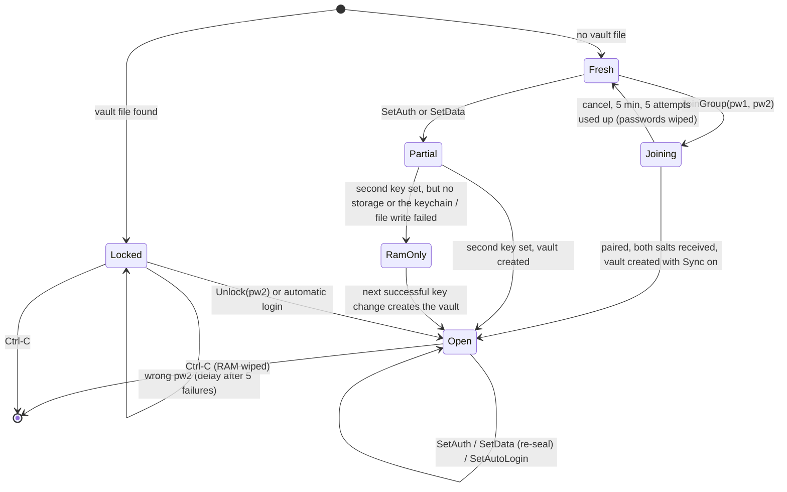

# CesaConn daemon: the complete design

This is the one design document for the daemon (`cesa_conn_networker`) and
for everything security-related that it owns: keys, storage, the UI IPC,
discovery, the `auth_snow` handshake, the transport, pairing, salt sync and
the sync features (clipboard sync today). If code and this file disagree, one of them has a
bug: fix the code or fix this file in the same PR.

It replaces `docs/design/salt-sync-and-clipboard.md`; all of that content
(groups and salt sync, clipboard v1, storage) is in sections 11, 12 and 8.

Every section is marked with its state:

- **[built]**: in `main`, with tests.
- **[planned]**: designed and agreed, no code yet.
- **[open]**: needs a decision before it can be built.

---

## Contents

1. What the daemon is
2. Ground rules (binding)
3. Threat model
4. Secrets inventory
5. Process architecture
6. Lifecycle and state machine
7. Local IPC (UI <-> daemon)
8. Storage: keychain and vault
9. Network layer: discovery, listener, limits
10. `auth_snow`: the handshake
11. Groups and salt sync
12. Clipboard sync (v1)
13. Networking switch and pairing over IPC
14. Rotation, revocation, reset
15. Platforms
16. Logging and error disclosure
17. Verification: tests and the security gate
18. Known weaknesses and limits
19. Decisions log
20. Implementation status and order

---

## 1. What the daemon is

One long-running process per user and device. It is the only place where
keys exist. Every UI (today the TUI, later a GUI) is a thin client that talks
to it over a private local socket.

The daemon **does**:
- derive `a_key` and `d_key` from the passwords (Argon2id) and keep them;
- own every salt, the device identity and the trusted-peer list;
- save its state in the encrypted vault and the OS keychain;
- answer UI requests (status, set password, unlock, automatic login, list
  peers, Sync, "Add device", pairing answers, joining a group);
- run discovery, accept and open connections, authenticate peers with
  `auth_snow`, ask the user to confirm new devices, and hand a joining
  device the group's salts (sections 11, 13);
- sync the clipboard between paired devices (section 12) and tell the UI
  what connecting to each paired device showed, an incorrect password
  above all (section 13.1).

The daemon **never**:
- sends a key, a salt or any key-derived secret to a UI;
- writes anything secret to disk unencrypted, configs included;
- puts anything password-derived into a discovery packet;
- trims or otherwise changes a password.

Binary: `cesa_conn_networker`. With no argument, `main` runs `daemon::run()`
(unix only; other platforms log an error and exit). With
`--features test-commands`, the subcommands `servertest` / `clienttest` run
the manual two-machine test instead (section 17). Any other argument is
refused.

Logging: `tracing`, default `cesa_conn=debug` in debug builds and
`cesa_conn=info` in release builds; `RUST_LOG` overrides it.

---

## 2. Ground rules (binding)

These are Czarek's decisions. Every design and every PR must keep them.

1. **Secrets live in exactly three places**: daemon memory (zeroized), the OS
   keychain, or an encrypted file. That covers keys, salts and anything
   derived from them.
2. **The UI holds nothing key-related.** A typed password exists in the UI
   only transiently, in a zeroizing buffer, is handed to the daemon and wiped
   at once. Salts are never shown or kept in the UI.
3. **The daemon owns `a_key` / `d_key`.** No IPC command ever exports key
   bytes. The UI gets status and public peer info only.
4. **Passwords are used exactly as typed.** Never trimmed, never normalised.
5. **Nothing is stored unencrypted**, configs included.
6. **Two independent passwords.** `pw1 -> Argon2id(a_salt) -> a_key` is for
   authentication only; `pw2 -> Argon2id(d_salt) -> d_key` is for data only.
   (Section 18 lists exactly where this independence stops.)
7. **Argon2id is pinned**: v0x13, m = 64 MiB, t = 3, p = 1, 32-byte output.
   The parameters are part of the protocol; changing them changes every key.
8. **SPAKE2 is the only trust decision for the password.** Nothing on the
   wire may be a password-derived value that allows an offline guess.
9. **UDP discovery carries nothing derived from a password or a salt.**
10. **Every feature is off by default**, networking included, also after updates.
11. **Every network read has a timeout, every length from the wire is bounded
    before allocating, every handshake has a deadline.**
12. **No `#[allow(dead_code)]` / `allow(unused*)`.** Unwired code keeps its
    warnings visible.
13. **`#![forbid(unsafe_code)]`** in every crate.
14. **Review loop**: review, fix everything, review again from scratch, until
    a full pass finds nothing. That applies to this document too.

---

## 3. Threat model

### 3.1 Assets

| Asset | Why it matters |
|---|---|
| `pw1` / `a_key` | lets a device join the group and authenticate |
| `pw2` / `d_key` | decrypts all synced data |
| identity seed | lets a device impersonate this device to its paired peers |
| trusted-peer list | decides who is accepted without asking the user |
| synced data (clipboard, later files) | the user's content |
| device linkability | which devices belong together, across networks |

### 3.2 Adversaries and what each one gets

| Adversary | Can | Must not get |
|---|---|---|
| Passive LAN / network observer | see every packet | any key, any (classical) offline password guess, any synced data |
| Active network attacker (MITM, no password) | drop, inject, replay, redirect, flood | anything above; at most a failed connection (DoS) and one online guess per connection, rate limited |
| Attacker who knows `pw1` only | complete SPAKE2 and Noise | trust without the user confirming the pairing code; any synced data (needs `d_key`) |
| Attacker who knows `pw1`, paired by a user who accepted the code | everything a paired device gets | plaintext data without `pw2` (see the offline-guess caveat in 18) |
| Other local user | connect to sockets, read world-readable files | the IPC (uid gate), the vault (0700 dir, 0600 file), keychain items |
| Same-user local process | everything the user can do | **only stopped on macOS signed builds** (code-requirement gate); otherwise out of scope, see 3.3 |
| Thief of the disk / backups | the vault file | contents without `pw2`; on top of that the keychain salts are needed for even an offline guess |
| Quantum attacker recording traffic today ("harvest now") | break X25519 / Ed25519 later | session keys and data (protected by ML-KEM-1024 in the PSK); **not** the SPAKE2 password-guess resistance, see 18 |

### 3.3 Out of scope

- root / kernel / a debugger attached to the daemon: it can read daemon memory.
- An unsigned build on a machine where malware already runs as the user: that
  process can talk to the daemon like the TUI can. Signed releases with
  `CESA_IPC_CODE_REQUIREMENT` close this on macOS (section 7.2).
- The OS clipboard itself: once content is in it, other apps can read it.
- Copies of secrets inside dependencies we can't wipe (section 18).

---

## 4. Secrets inventory

Every secret, how it is made, where it lives and for how long.

| Secret | Made from | Lives in | Lifetime |
|---|---|---|---|
| `pw1`, `pw2` | the user | UI input buffer, then the IPC frame buffers and `PasswordUpdate` on both ends (all `Zeroizing`) | UI: until sent; daemon: until Argon2 finishes; then wiped |
| clipboard text (not a key, but often a password) | the user / a paired device | the OS clipboard; daemon RAM (`Zeroizing`) while it is read, sent or applied | daemon: one send or apply, then wiped |
| `a_salt` (32 B) | OS RNG, daemon, first `SetAuthPassword` | daemon RAM; vault | for good |
| `d_salt` (32 B) | OS RNG, daemon, first `SetDataPassword` | daemon RAM; keychain item `salts` | for good |
| storage salt (32 B) | OS RNG, at vault creation | keychain item `salts` | for good |
| `a_key` (32 B) | `Argon2id(pw1, a_salt)` | daemon RAM (`AuthKey`); vault | until pw1 changes |
| `d_key` (32 B) | `Argon2id(pw2, d_salt)` | daemon RAM (`DataKey`) only; keychain item `data-key` only with automatic login | until the daemon stops / pw2 changes |
| KEK (32 B) | `HKDF-BLAKE2s(ikm = d_key, salt = storage salt, info = "cesaconn-storage-v1")` | computed on demand, wiped | one operation |
| DEK (32 B) | OS RNG, at vault creation | daemon RAM while open; on disk only wrapped by the KEK | for good (re-wrapped on pw2 change) |
| identity seed (64 B) | OS RNG, at vault creation: `X25519 private (32) \|\| ML-DSA-87 seed (32)` | daemon RAM; vault | for good: same seed = same device |
| trusted peers | pairing | daemon RAM; vault | until removed |
| SPAKE2 key `key1` | SPAKE2 | handshake task | one handshake |
| hybrid shared secrets | X25519 + ML-KEM-1024 | handshake task | one handshake |
| PSK | HKDF (10.4) | handshake task | one handshake |
| Noise transport keys, handshake hash | Noise | `SecureConnection` | one connection |
| data-layer keys | HKDF(`d_key`, handshake hash, direction label) | computed per message | one message |

Types: keys are newtypes (`AuthKey`, `DataKey`) over `Zeroizing<[u8; 32]>`,
with no `Debug` and no `Copy`, readable only through `expose()`, so `a_key`
can't be passed where `d_key` is expected. `Salts`, `VaultContents` and
`PasswordUpdate` have no `Debug` / `Clone`. Buffers holding secrets are sized
up front so they never reallocate (a reallocation would leave an unwiped copy).

---

## 5. Process architecture

### 5.1 Runtime **[built]**

One tokio multi-thread runtime (`#[tokio::main]`). Blocking work (Argon2, the
keychain, file I/O, the macOS Security framework) always runs in
`spawn_blocking`, never on the async workers.

Tasks today:
- the IPC server (`ipc_server::serve`), one task per UI connection;
- one task per state change (so an IPC deadline can't cancel it halfway).

Tasks while networking runs **[built]** (section 13):
- the TCP listener (`tcp_networker::recv`), one task per connection;
- the pairing bridge: pairing requests from the handshakes to the UI, and
  re-sealing the vault after a new peer was saved;
- during an "Add device" invite window (2 min): UDP announce, UDP search
  rounds with one task per outgoing connection, the salt query listener
  (section 11.4) and the window timer;
- during a join (section 11): one task that searches, queries the salt,
  derives and connects; the commit runs as its own task;
- the clipboard task (section 12, only where there is a clipboard): it
  polls the clipboard, applies updates from paired devices, and starts one
  send round at a time (one task per paired device);
- a hello round (13.1) when networking starts and after a key change.

Shutdown: Ctrl-C cancels a `CancellationToken`; the IPC server stops
accepting, the daemon waits for it, stops networking (the bridge saves the
peers once more, at most 5 s) and removes its socket file (best effort; a
stale socket is replaced on the next start anyway).

### 5.2 Shared state **[built]**

```text
pub struct Daemon {
    keys: RwLock<KeySlots>,                      // keys, salts, open vault, lock state
    trusted_peers: Arc<RwLock<Vec<TrustedPeer>>>,
    derive_slot: Arc<Semaphore>,                 // 1: one Argon2 run (64 MiB) at a time
    change_slot: Arc<Semaphore>,                 // 1: one state change at a time
    storage: Option<Storage>,                    // None = RAM only
    network: RwLock<Option<Network>>,            // token, NetworkerContext, bridge
    pairings: RwLock<PendingPairings>,           // requests waiting for the user
    adding: AtomicBool,                          // "Add device" window open
    join: RwLock<Option<JoinSlot>>,              // the running join (generation, token)
    guess_limiter: Arc<GuessLimiter>,            // one for the daemon's lifetime
    peer_book: Arc<PeerBook>,                    // last address + state per paired device (13.1)
    clipboard: Option<Arc<dyn Clipboard>>,       // the OS clipboard (12.7), None where unsupported
}

struct KeySlots {
    a_key, d_key: Option<AuthKey / DataKey>,
    a_salt, d_salt: Option<Zeroizing<[u8; 32]>>,
    vault: Option<OpenVault>,   // DEK, wrapped DEK, storage salt, config, identity seed
    locked: bool,               // a saved vault exists but isn't open
    auto_login: bool,           // d_key is in the keychain
    unlock_failures: u32,
}
```

### 5.3 Concurrency rules **[built]**

- tokio `RwLock`s only (no `std::sync` locks in the networker). They are not
  re-entrant: never take the same lock twice in one scope.
- **No guard is held across an `.await`.** Values are cloned (zeroizing) under
  the guard and the guard is dropped before any I/O, Argon2 or keychain call.
- **Never hold two locks at once.** The trusted peers are read (and encoded)
  *before* the key lock is taken.
- Check-then-act happens under one write guard (`salt_for`: check and create
  the salt under the same guard).
- **One state change at a time, end to end.** `handle()` waits for the
  `change_slot` *before* spawning, so a waiting request owns no task; once it
  holds the slot, the change runs in its own task and finishes as a whole even
  if the IPC deadline drops the request (never half-saved).
- **One Argon2 at a time.** The `derive_slot` permit moves into the blocking
  task and is released only when Argon2 really finished, even if the caller
  was dropped.
- Saved first, kept second: a key change is written to the vault before it
  replaces the key in RAM, so a failed save changes nothing.

---

## 6. Lifecycle and state machine

### 6.1 States **[built]**



`Status` shows it: `auth_key_set`, `data_key_set`, `locked`, `saved`,
`auto_login`, `sync_enabled`, `network_running`, `adding_device`,
`joining`, `trusted_peers`, `unlock_wait_secs`, `pending_pairings`,
`clipboard_enabled`, `clipboard_unavailable`.

Setting both passwords on a fresh device creates a new group (the daemon
makes both salts); `JoinGroup` joins an existing one (section 11).

Networking runs exactly while the vault is open, both keys are set and the
Sync switch is on (section 13); every state change re-checks it.

Without storage (Linux and others today, or no safe data directory) the
daemon is RAM only: keys are gone after a restart, `Unlock` and
`SetAutoLogin` answer `NotSaved`, and it logs a warning.

### 6.2 Start **[built]**

1. Build the IPC client policy from the build-time code requirement; refuse
   to start if it doesn't parse.
2. Find and check the socket path, bind it (7.2).
3. Pick storage (`platform_storage()`: macOS only, vault in the private data
   dir, keychain = `OsKeychain`).
4. `start()`: no vault file -> Fresh. A vault file (even an unreadable one) ->
   Locked. Then, if the keychain has a `data-key` item, try automatic login:
   - wrong size: stay locked, warn;
   - it no longer opens the vault: delete it from the keychain, stay locked;
   - success: Open.
5. Serve IPC until Ctrl-C.

### 6.3 First setup **[built]**

1. `SetAuthPassword(pw1)` / `SetDataPassword(pw2)`, in any order. Each is
   refused below 12 characters (`MIN_NEW_PASSWORD_LEN`, counted in Unicode
   characters, bytes if not UTF-8). The salt is made on first use and kept.
2. When both keys exist and no vault does, `create_vault()`:
   1. new storage salt, DEK, identity seed;
   2. `KEK = HKDF(d_key, storage salt)`, wrap the DEK, seal the contents;
   3. write `d_salt || storage salt` to the keychain;
   4. write the vault file atomically;
   5. only then keep the open vault in RAM.
   Any failure: keys stay in RAM only (`saved = false`), nothing half-written;
   the next key change tries again.

### 6.4 Unlock **[built]**

`Unlock(pw2)` (only while Locked; otherwise `BadRequest` if open, `NotSaved`
if there is no vault):
1. inside the unlock delay: refused at once with `UnlockDelayed`, before any
   keychain access or Argon2, and not counted as another guess;
2. read the salts from the keychain (missing or unreadable: `StorageFailed`);
3. `d_key = Argon2id(pw2, d_salt)`, `KEK = HKDF(...)`, open the vault;
4. wrong password = the DEK wrap fails its GCM tag -> `WrongPassword`, the
   counter goes up and the next attempt is refused for `unlock_delay(failures)`:
   the first 5 attempts run back to back, after the 5th wrong password it is
   1 s, doubling to 60 s. A damaged file is `StorageFailed`, never
   `WrongPassword`;
5. success: load `a_key`, `a_salt`, identity, config, peers; counter and
   delay reset.

The delay is a "not before" time, not a sleep: a sleep held the change slot
and outlasted the 10 s IPC deadline from the 10th attempt on, so the UI got a
timeout even for the right password. `Status` reports the seconds left
(`unlock_wait_secs`); the TUI shows them in the status bar and doesn't open
the password field until the wait is over.

The TUI asks for the data password by itself as soon as it sees a locked
daemon (a restart without automatic login), on any tab: an "Unlock" prompt,
masked, sent exactly as typed. Once per locked spell: Esc leaves it to
Settings > Data key, a wrong password or a daemon that comes back locked
asks again. It waits while the daemon refuses unlocks, never covers another
popup (it opens on the next refresh), and closes, wiped, when the vault was
unlocked some other way. The guessing rate is the same as
with the sleep: one Argon2 attempt per delay.

The failure counter is in RAM, so a daemon restart resets it. That is
accepted: every attempt still costs a 64 MiB Argon2 run, and a process that
can restart the daemon runs as the user anyway (3.3).

### 6.5 Changing a password **[built]**

The UI asks "are you sure?" before sending a new password for a key that is
already set. The old password is **not** required (his decision).
- New `pw1`: derive with the existing `a_salt`, re-seal the vault with the new `a_key`.
- New `pw2`: derive with the existing `d_salt`, re-wrap the DEK under the new
  KEK, re-seal; with automatic login, replace the keychain `data-key`. If the
  keychain refuses, the old item is deleted and automatic login turns off
  (a stale key must not stay behind).

Until group rotation exists (section 14), a local password change once peers
exist breaks pairing with the devices that still have the old password.
His decision: the change is allowed, and the mismatch is **shown as
"incorrect password"** when the devices connect (section 13.1) **[built]**:
- right after the change the daemon sends a hello to every paired device,
  so both sides show it at once, not only at the next clipboard copy;
- the TUI also says, when the change succeeds and devices are paired, that
  they still have the old password and must get the same new one;
- setting the same password on the other device (or back on this one)
  makes both show the device as fine again with the next hello.

### 6.6 Automatic login **[built]**

Opt-in, after this warning: *"Your data key will be stored in the OS keychain.
Its security then depends on your operating system and account: anyone who can
unlock your user session can use it. We can't vouch for that."* On: `d_key`
goes into the keychain item `data-key`. Off: the item is deleted. Needs an
open, saved vault (`Locked` / `NotSaved` otherwise).

---

## 7. Local IPC (UI <-> daemon)

### 7.1 Transport **[built]**

A Unix domain socket, one request and one response per connection. No XPC,
D-Bus or ALPC (three implementations for little gain).

Socket: `<base>/cesaconn/daemon.sock`
- base = `$XDG_RUNTIME_DIR` (Linux; no fallback, never `/tmp`), or the macOS
  per-user temp dir (`/var/folders/.../T/`);
- the `cesaconn` directory is created `0700` and **re-checked on every use**:
  a real directory (not a symlink), owned by us, no group/other bits;
- the socket itself is `0600`.

Binding: an existing path is removed only if it is a socket owned by us that
nobody listens on. Something else there is `SocketPathTaken`; a live daemon is
`AlreadyRunning`.

### 7.2 Who may talk to whom **[built]**

Daemon side, for every connection, **before reading a byte**:
1. kernel peer credentials: the peer's uid must equal ours;
2. macOS, if built with `CESA_IPC_CODE_REQUIREMENT`: the peer's code signature
   must satisfy it. The peer is looked up by its **audit token** (pid + pid
   version, taken by the kernel at connect time), so a recycled pid or a
   socket handed to another process can't fool the check. It is a dynamic
   check (`check_validity`): the running code must still match its signature.
   Unset: the daemon logs a loud error at start ("IPC CLIENT SIGNATURE CHECK
   DISABLED"). On other platforms a requirement is refused, so it can never
   look like protection that isn't there.

UI side, **before sending a byte** (and so before any password leaves):
1. the directory is still private;
2. the daemon's uid equals ours (`UntrustedDaemon` otherwise);
3. macOS, if built with `CESA_IPC_DAEMON_CODE_REQUIREMENT`: the daemon's
   signature, same audit-token check. Unset: the TUI warns. Set but invalid:
   every daemon is refused (fails closed) and the TUI says why.

Both requirements are only meaningful with a Developer ID signature and the
hardened runtime (otherwise code can be injected). That comes with release
signing **[open: needs his Apple Developer ID]**.

### 7.3 Limits **[built]**

| Limit | Value |
|---|---|
| clients at once | 4 (`MAX_CONCURRENT_CLIENTS`); more are closed at once, not queued |
| time per connection, checks included | 10 s (`REQUEST_DEADLINE`) |
| each read / write | 5 s (`IO_TIMEOUT`) |
| frame body | 1 ..= 72 KiB (`MAX_FRAME_LEN`), checked before allocating |
| password | 1 ..= 1024 bytes (`MAX_PASSWORD_LEN`) |
| peers in `ListPeers` | 256 |
| failed `accept` | 100 ms back-off, no busy loop |

Frames that carry a request are read into `Zeroizing` buffers (a request may
hold a password). Compile-time asserts keep the largest request and the
largest `ListPeers` answer under `MAX_FRAME_LEN`.

### 7.4 Wire format, version 9 **[built]**

```
frame    = length (u32 LE, 1..=MAX_FRAME_LEN) || body
request  = kind (1) || payload
response = 0x00 || payload        (success)
         | 0x01 || error code (1) (error)
```

| Kind | Request | Payload | Success payload |
|---|---|---|---|
| `0x01` | Status | none | `flags (1) \|\| flags2 (1) \|\| trusted peers (u32 LE) \|\| unlock wait (u16 LE, seconds) \|\| pending pairings (u8)` |
| `0x04` | ListPeers | none | `count (u16 LE) \|\| count * (fingerprint (8) \|\| state (1) \|\| name len (1) \|\| name)` |
| `0x05` | SetAuthPassword | `password` | empty |
| `0x06` | SetDataPassword | `password` | empty |
| `0x07` | Unlock | `password` (the data password) | empty |
| `0x08` | SetAutoLogin | exactly `0x00` or `0x01` | empty |
| `0x09` | SetSync | exactly `0x00` or `0x01` | empty |
| `0x0A` | AddDevice | none | empty (the window runs in the background) |
| `0x0B` | PendingPairing | none | `0x00` (none) or `0x01 \|\| id (u32 LE) \|\| code (8) \|\| name len (1) \|\| name` |
| `0x0C` | AnswerPairing | `id (u32 LE) \|\| code (8) \|\| accept (exactly 0x00 or 0x01)` | empty |
| `0x0D` | JoinGroup | `auth len (u16 LE) \|\| auth password \|\| data password`, each `1..=MAX_PASSWORD_LEN`, consumed exactly | empty (the join runs in the background) |
| `0x0E` | CancelJoin | none | empty |
| `0x0F` | StopAddDevice | none | empty (also when no window is open) |
| `0x10` | ForgetPeer | `fingerprint (8)`, exactly | empty (14.1) |
| `0x11` | ResetDevice | exactly the 8 bytes `CN-RESET` | empty (14.2) |
| `0x12` | SetClipboard | exactly `0x00` or `0x01` | empty (12.1) |
| `0x13` | AddDeviceAt | `address` | empty (13.2) |
| `0x14` | JoinGroupAt | `address \|\| JoinGroup's payload` | empty (13.2) |
| `0x02`, `0x03` | retired (v1 sent `salt \|\| password`) | refused, so a mismatched UI and daemon fail loudly | |

`address` = `0x04 (1) || IPv4 (4)`, exact length. Refused (`BadRequest`):
unspecified, loopback, multicast, the broadcast, and every other family
byte. `0x06` is reserved for IPv6: the listener and the salt query bind
IPv4 only (9.2), so an IPv6 address would never be answered. The TUI takes
an IPv4-mapped IPv6 address as its IPv4 address.

Status flags: bit 0 auth key set, 1 data key set, 2 network running, 3 vault
locked, 4 keys saved, 5 automatic login, 6 Sync switched on, 7 "Add device"
window open. Flags2: bit 0 joining a group, bit 1 the open "Add device" window found a
device of another group (13), bit 2 clipboard sync switched on, bit 3 this
platform has no clipboard support (12.7), every other bit must be 0 (so an
older UI refuses a newer status loudly).
Unlock wait: seconds until `Unlock` is accepted again (0 = now). Pending
pairings: how many wait for the user; the UI asks `PendingPairing` only
then. Versions 2 to 4 had shorter status answers; they are `Malformed`, so a
mismatched UI and daemon fail loudly.

`JoinGroup` decodes both passwords into separate exact-size `Zeroizing`
buffers, never trimmed; the longest request body is
`1 + 2 + 2 * MAX_PASSWORD_LEN` (a compile-time assert keeps it in a frame).

`PendingPairing` gives the oldest waiting pairing. Its code is 8 symbol
indices, each below 64 (section 10.7); the decoder refuses anything else, a
name that isn't UTF-8 and a name with control characters (it is printed in
a terminal).

A fingerprint is the first 8 bytes of the peer's X25519 static public key,
for telling devices apart in the UI; it is not a security check. Names are cut
to 255 bytes on a char boundary. The state byte is what the last connection
with the device showed (13.1): `0x00` not contacted yet, `0x01` fine,
`0x02` the auth password differs, `0x03` the data password differs, `0x04`
not reachable at its last address; the decoder refuses anything else.

Error codes: `0x01` BadRequest, `0x02` KeyDerivationFailed, `0x03` Internal,
`0x04` WrongPassword, `0x05` Locked, `0x06` StorageFailed, `0x07` NotSaved,
`0x08` WeakPassword, `0x09` UnlockDelayed, `0x0A` NetworkOff (AddDevice
while networking doesn't run), `0x0B` PairingExpired (no waiting pairing has
that id and code: answered already, timed out, or a different pairing),
`0x0C` AlreadyInGroup (JoinGroup on a device with keys, a vault or a lock),
`0x0D` JoinRunning (JoinGroup while a join runs), `0x0E` UnknownPeer
(ForgetPeer: no paired device has that fingerprint), `0x0F`
ClipboardUnavailable (SetClipboard on on a platform without clipboard
support), `0x10` OwnAddress (AddDeviceAt / JoinGroupAt with an address of
this machine).

`ResetDevice` carries fixed confirm bytes so that nothing sent by mistake
(a wrong kind byte, a UI bug) decodes as a reset; the user's confirmation
itself is in the UI (typing `RESET`, 7.5). Version 7 only added requests and
an error code. Version 8 adds `SetClipboard`, two status bits, an error
code and the state byte in `ListPeers`: a version 7 UI fails on the peer
list loudly (`Malformed`), as intended. Version 9 only adds two requests
and an error code: a version 8 daemon answers them with `BadRequest`.

An answer names the id **and the code** the user saw. Ids start at 0 again
when the daemon restarts, so an id alone could land on a newer pairing that
nobody compared; with the code it can only accept exactly what was shown.

Decoding is strict: anything not exactly well-formed is refused (`BadRequest`
from the daemon, `Malformed` in the client), and responses are decoded for
the request they answer.

### 7.5 What the UI client must do **[built in the TUI]**

- Hold a typed password only in a zeroizing input buffer, put it into a
  `PasswordUpdate`, send it, and drop the request right after sending.
- Run IPC on its own worker thread (the TUI: one thread with a small
  current-thread tokio runtime), so Argon2 in the daemon never blocks the UI.
- Keep nothing key-related: no keys, no salts, no handshake hashes.
- Show the daemon's warnings (unsigned daemon, invalid requirement) instead of
  hiding them.
- Show only what the daemon really has: no setting, list or counter without a
  daemon value behind it. (The early TUI placeholders, Auto-connect, UDP
  discovery, listen address and port, broadcast duration, a "connected"
  counter and a device list nothing filled, were removed; the Devices tab
  shows the paired devices from `ListPeers` and what the daemon is doing.)
- Ask for what the daemon needs instead of sending the user looking for it:
  a locked daemon gets the unlock prompt at once (6.4).

### 7.6 Command set policy

The command set grows with the UI; it is not designed up front (his
decision). Planned additions are listed where they are designed: section 11.7
(groups). The sync switch and the pairing prompt (section 13) and the
clipboard switch (12) are built.

---

## 8. Storage: keychain and vault

### 8.1 Where each thing is **[built]**

| What | Where |
|---|---|
| `d_key` | daemon RAM only; with automatic login also the keychain |
| `d_salt` + storage salt | the OS keychain (device-only, never synced) |
| `a_key`, `a_salt`, identity seed, trusted peers, config | the vault file, encrypted |

### 8.2 Keychain **[built on macOS]**

Service `dev.czarekk.cesaconn`, two generic-password items:
- `salts`: `d_salt (32) || storage salt (32)`;
- `data-key`: `d_key (32)`, automatic login only.

macOS: the login keychain with synchronisation off (never iCloud). The
data-protection keychain with `WhenUnlockedThisDeviceOnly` needs the
entitlement that comes with release signing **[open]**. Values come back in
`Zeroizing`; the copy inside the Security framework (`CFData`) is released by
the OS and can't be wiped from here. Behind the `SecretStore` trait, so tests
use memory.

### 8.3 Vault file format, version 2 **[built]**

Path: macOS `~/Library/Application Support/cesaconn/vault.bin`, elsewhere
`$XDG_DATA_HOME/cesaconn/vault.bin` or `~/.local/share/cesaconn/vault.bin`
(directory `0700`, checked like the IPC directory).

```
MAGIC "CESAVLT\0" (8) || VERSION 0x02 (1)               header
wrap nonce (12) || AES-256-GCM(KEK, DEK) (32 + 16)       AAD = header || "cesaconn-vault-dek"
data nonce (12) || AES-256-GCM(DEK, plaintext) (n*4096 + 16)  AAD = header || "cesaconn-vault-data"
```

- `plaintext = contents len (u32 LE) || contents || zeros`, padded to whole
  4096-byte blocks, so the size doesn't reveal how many peers or how much
  config there is. Unpadding is strict: every padding byte must be zero.
- `contents` is TLV, `tag (1) || len (u32 LE) || value`, every tag exactly
  once and in this order, nothing after:
  `0x01 a_key (32)`, `0x02 a_salt (32)`, `0x03 config (<= 64 KiB)`,
  `0x04 identity seed (64)`, `0x05 peers (<= 1 MiB)`.
- config, version 2: `version 0x02 (1) || flags (1) || addresses`, flag
  bit 0 = Sync, bit 1 = clipboard sync; every other bit must be 0.
  `addresses` are the paired devices' last addresses (13.1):
  `count (u16 LE, <= 256) || count * (x25519 key (32) || family (1: 4 or 6)
  || ip (4 or 16) || port (u16 LE))`, exact length, no duplicate keys, only
  devices in the peer list are written. Version 1 (`0x01 || flags`, Sync
  only) is still read and written back as version 2 with the next save.
  Empty = all defaults (vaults written before there were settings).
  Anything else is damaged (`StorageFailed` on unlock).
- peers: `count (u16 LE) || count * (x25519 pub (32) || ML-DSA-87 vk (2592) ||
  name len (u8) || name)`, at most 256 peers, names at most 255 bytes with no
  control characters (no terminal escapes in the TUI), no duplicate keys,
  exact length.
- Every seal uses a fresh random 96-bit nonce under the same DEK (and every
  wrap one under the KEK). A device seals once per change (a password, a new
  peer), far below the ~2^32 encryptions where random GCM nonces get risky.
- The only plaintext on disk is the format metadata: magic, version, nonces,
  ciphertexts. No salt, key, config value or content length.
- Version 1 files are refused (`Malformed`).

Reading: the directory is re-checked; the file must be a regular file of ours
with no group/other bits and at most 4 MiB, checked before reading and bounded
while reading. Writing: a new `0600` temp file with a random name in the same
directory (`create_new`), written, fsynced, renamed over the old file, then
the directory is fsynced; a failed write removes the temp file.

Errors: a failed DEK unwrap is `WrongKey` (the only place a wrong password
shows); a DEK that unwraps but contents that don't decrypt or parse is
`Corrupt`. The daemon maps `WrongKey` to `WrongPassword` and everything else
to `StorageFailed`, with details only in the daemon log.

### 8.4 Known costs **[accepted]**

- Anyone holding the vault file **and** the keychain salts can try data
  passwords offline at Argon2 speed (64 MiB per guess). Hence the 12-character
  minimum; a strength hint in the UI is **[planned]**.
- Cracking `pw2` from the vault also yields `a_key` (it is inside), so at rest
  the two passwords are not independent: see section 18.
- Linux has no keychain backend yet (Secret Service needs a dependency
  decision), so Linux is RAM only and says so. Headless Linux has no Secret
  Service at all.
- A forgotten data password means the vault can't be opened. Reset comes with
  section 14.

---

## 9. Network layer: discovery, listener, limits

### 9.1 Discovery (UDP) **[built; the daemon runs it only in the "Add device" window]**

- Port 3636. Announcement = `"CESACONN" (8) || version 0x01 (1) || instance id (16)`,
  25 bytes, sent once per second to `255.255.255.255` **and to the
  broadcast address of every other IPv4 interface** **[built]**. The OS
  sends `255.255.255.255` out of the default-route interface only, so a
  second network on the same machine (a VM's shared network such as
  Parallels' `bridge100`, Ethernet next to Wi-Fi) never heard it. Usable =
  up, broadcast-capable, not loopback, not point-to-point (VPN tunnels have
  no broadcast); the reported broadcast address, or the network's last
  address; nothing for /31 and /32, nothing outside the interface's own
  network, each address once, at most 16 destinations. The list is read
  again every second (`getifaddrs` through `nix`, safe API), so an
  interface that comes up during a window is used too. `255.255.255.255`
  is sent first, then every interface at once (each send bounded by 1 s), so
  a slow or refusing network neither stops nor delays the others; the round
  fails only if no destination took it. Windows: `255.255.255.255` only for now. Receivers
  are unchanged (a wildcard bind gets directed broadcasts too), so older
  versions hear it.
- The instance id is random per start, only so a device ignores its own
  broadcasts. It is not an identity and not a secret.
- The listener accepts exactly 25-byte packets with the right magic and
  version; one search has one deadline, so junk can't extend it; broadcasts
  and searches are capped at 20 s each.
- **Nothing in an announcement is derived from a password or a salt.** A
  password-derived value (for example AES-GCM of a known name under `a_key`)
  would let anyone on the LAN capture one packet and guess the password
  offline. So the result of discovery is only a hint where to connect: only
  the IP is used, the port is fixed, and trust is decided by the TCP handshake
  alone. Forged or replayed announcements can at most cause a failed connection.
- The daemon does not announce itself all the time: only during an "Add
  device" invite window (2 min, section 13), in 20 s rounds, while it also
  searches in 20 s rounds. A joining device only searches (it never
  announces, so other members don't connect to it). A search keeps one entry per sending IP (only the IP is used), at
  most 16 (`MAX_FOUND_DEVICES`), and always runs to its deadline, so a flood
  of made-up ids from one address can't push real devices out.

### 9.2 TCP listener **[built]**

- Port 3232 (`TCP_PORT`), on every interface (paired devices on the LAN must
  reach it), only while networking runs. The test commands use the same port.
  If the port can't be bound, networking stays off and the UI shows the
  network as "failed" (Sync on, not running).
- At most 16 unauthenticated connections at once (`MAX_CONCURRENT_CONNECTIONS`);
  a connection over the cap is closed at once, not queued.
- Each connection runs `recv_handler` in its own task, cancelled with the
  daemon's token.

### 9.3 Bluetooth **[open, no code]**

No Bluetooth transport and no design yet. The unused `btleplug` dependency
was dropped (it was attack surface without a feature, and ~500 lines of
`Cargo.lock`); a Bluetooth design starts from scratch if it is ever wanted.

### 9.4 Online guess limiter **[built]**

SPAKE2 allows exactly one password guess per connection, so the remaining
attack on `pw1` is many connections. `guess_limiter` counts failures per
source: one IPv4 address, or one IPv6 /64 (IPv4-mapped IPv6 is treated as
IPv4).

- 5 failures in a row lock the source out for 1 min, doubling with each
  further lockout up to 1 h. A successful handshake resets the source.
- At most 4096 sources tracked; stale ones (not locked, quiet 2 h) are
  dropped first; if it is still full, a new source is not tracked (better
  than locking out everybody new).
- **Server side**: a locked source gets no handshake at all; a wrong client
  confirmation counts as a failure.
- **Client side**: a fake server learns one guess from our confirmation value,
  so servers are counted too, and we don't connect to a locked one. Counted:
  a wrong server confirmation, any failure of the confirmation step
  (`FailedToConfirmMutualAuthSpake2`, which also covers a server that hangs up
  instead of answering), and any `HandshakeTimeout`. The last two also count
  failures that happened before our value was sent; that over-counts on
  purpose rather than miss a guess.
- A peer that disconnects *before* sending its confirmation learned nothing
  (a SPAKE2 transcript alone doesn't allow an offline guess), so it isn't counted.

---

## 10. `auth_snow`: the handshake

`auth_snow` turns a TCP stream into an authenticated, encrypted
`SecureConnection` to a known (or newly confirmed) device. Entry points:
`auth_incoming` (server) and `auth_outgoing` (client); both return
`Ok(Some((SecureConnection, TrustedPeer)))` on success and `Ok(None)` when
the peer failed SPAKE2 (wrong `a_key`).

### 10.1 Overview **[built]**

| Phase | What | Proves / gives |
|---|---|---|
| 1 | SPAKE2 (Ed25519 group) with `a_key` + key confirmation | both know `pw1`; shared `key1` |
| 2 | hybrid KEX: X25519, then ML-KEM-1024 | two fresh shared secrets, one post-quantum |
| 3 | PSK = HKDF(key1, both secrets, transcript hash) | binds everything before Noise together |
| 4 | Noise `XXpsk3_25519_ChaChaPoly_BLAKE2s` with the device's static key | encrypted transport; peer's static key; handshake hash |
| 5 | IsSaved exchange + mutual ML-DSA-87 signatures over the handshake hash | peer owns its identity key; known peers are pinned |
| 6 | pairing confirmation, only if the two don't both know each other | a human approved the new device |

Roles: the client is the TCP initiator, SPAKE2 side A, the Noise initiator,
and sends first wherever both sides send.

```
client                                              server
  |  SPAKE2 msg A (33 + tag)          ---->            |
  |            <----      SPAKE2 msg B (33 + tag)      |
  |  confirm C->S (32)                ---->            |   wrong: close, count guess
  |            <----      confirm S->C (32)            |
  |  X25519 pub (32 + tag)            ---->            |
  |            <----      X25519 pub (32 + tag)        |
  |  confirm byte                     ---->            |
  |  ML-KEM-1024 pub (1568 + tag)     ---->            |
  |            <----      ML-KEM ct (1568 + tag)       |
  |  confirm byte                     ---->            |
  |        (both: PSK = HKDF(...))                     |
  |  Noise msg1  -> e                 ---->            |
  |            <----      Noise msg2  <- e, ee, s, es  |
  |  Noise msg3  -> s, se, psk        ---->            |
  |  ===== Noise transport from here =====             |
  |  IsSaved (1)                      ---->            |
  |            <----      IsSaved (1)                  |
  |  ML-DSA vk (2592), sig (4627)     ---->            |   server verifies first
  |            <----      ML-DSA vk, sig               |
  |  [pairing decisions, if needed]   <--->            |
```

Phases 1-5 run under one deadline, `HANDSHAKE_DEADLINE` = 20 s, so a peer
can't drip one message every 4.9 s and hold a slot for minutes. Pairing waits
for a human, so it runs after the deadline, and only for a peer whose
signature already verified.

### 10.2 Phase 1: SPAKE2 **[built]**

- Crate `spake2`, `Ed25519Group`, password = the 32 bytes of `a_key`,
  identities `"CesaConn-client" || a_salt` (A) and `"CesaConn-server" ||
  a_salt` (B) on both sides. The salt is public; binding it means a device
  with a different (or fake) `a_salt` fails the confirmation explicitly,
  whatever key it derived (section 11.4).
- Each side sends its message (side byte + point = 33 bytes) plus tag `0x01`.
  Both messages, tags included, go into the transcript in the order client,
  server, on both sides. `finish()` checks length and side byte.
- Key confirmation, labels per direction so a value can't be reflected:
  `HKDF-BLAKE2s(ikm = key1).expand("CPQHA-confirm-client-to-server")` and
  `...("CPQHA-confirm-server-to-client")`, 32 bytes each.
- **The client proves first.** The server compares in constant time and only
  then sends its own value; a peer without the password learns nothing from
  the server. A wrong value (on either side) means `Ok(None)` and a counted
  guess (9.4). Both values are appended to the transcript on success.

Why SPAKE2 first: it is the only step that depends on the password, and it
gives an attacker exactly one online guess per connection and nothing to test
offline. Everything later is bound to its result.

### 10.3 Phase 2: hybrid key exchange **[built]**

Pre-Noise messages are plaintext on TCP; their integrity comes from the
transcript being mixed into the PSK (10.4), which only someone who passed
SPAKE2 can compute.

X25519 (fresh ephemeral key per connection, both sides):
1. client -> server: public key (32) + tag `0x01`;
2. server -> client: public key (32) + tag `0x01`;
3. client -> server: confirm `0x01` (or `0x00` if the server sent a low-order
   point) + tag `0x02`.
Both sides refuse a non-contributory (all-zero) shared secret.

ML-KEM-1024 (fresh key pair per connection):
1. client -> server: encapsulation key (1568) + tag `0x03`;
2. the server runs the FIPS 203 key check (`validate_public_key`), encapsulates,
   and sends the ciphertext (1568) + tag `0x03`;
3. client -> server: confirm `0x01` + tag `0x02`.
Decapsulation uses implicit rejection: a tampered ciphertext gives a random
key, which then fails at the Noise PSK step instead of leaking anything here.

Anything other than an explicit `0x01` confirmation is a rejection. Every
message, tags included, goes into the transcript in the same order on both
sides.

### 10.4 Phase 3: PSK **[built]**

```
transcript_hash = HKDF-BLAKE2s(ikm = transcript).expand("")           (32)
psk = HKDF-BLAKE2s(ikm = key1 || x25519_ss || mlkem_ss || transcript_hash)
          .expand("CPQHA-psk")                                         (32)
```

- `key1` binds the KEX to SPAKE2: a MITM that only relays SPAKE2 can't
  derive the PSK.
- `mlkem_ss` makes the session keys post-quantum: breaking X25519 alone isn't
  enough.
- The transcript hash makes any change to a pre-Noise message (a swapped key,
  a stripped confirm byte) a PSK mismatch, caught when Noise message 3 fails.

### 10.5 Phase 4: Noise **[built]**

- `Noise_XXpsk3_25519_ChaChaPoly_BLAKE2s` (crate `snow`), PSK at position 3,
  local static key = the device's X25519 identity key.
- Message sizes are fixed and checked: msg1 48 (e + empty-payload tag),
  msg2 96 (e, encrypted s, tag), msg3 64 (encrypted s, tag). All payloads
  are empty.
- After msg3: the peer's static public key (its identity, looked up in the
  trusted peers) and the 32-byte handshake hash, saved before switching to
  transport mode (snow only exposes it before). Every read and write has the
  5 s `TIMEOUT`.

The server's static key in msg2 is encrypted only under `ee` (the PSK enters
at msg3), so it is visible to whoever completes msg1. That is acceptable
because Noise only starts after SPAKE2 succeeded: only a holder of `pw1`
ever gets there.

### 10.6 Phase 5: identifying the peer **[built]**

Inside the Noise transport. The two steps always run in this order and the
message sequence never depends on what either side knows:

1. **IsSaved**: one byte each, client first (tag `0x05`): "I have you saved".
   `both_saved` is true only if both bytes are `0x01`.
2. **Signatures**: both sides *always* send their ML-DSA-87 verification key
   (2592, tag `0x02`) and a signature over the handshake hash (4627, tag
   `0x03`), client first. Contexts per role: `"CesaConn Client Handshake"` /
   `"CesaConn Server Handshake"`, so one side's signature can't be replayed as
   the other's. Signing is hedged (fresh 32 random bytes).
   - For a known peer, the received key must equal the stored one (constant
     time), otherwise `PeerKeyMismatch`: a device can't swap its identity key.
   - The signature is always verified with the received key, which proves the
     peer holds the private key.
   - **The server verifies the client before sending its own key and signature.**
   - The handshake hash is unique per connection and identical on both sides,
     so a valid signature proves the peer took part in exactly this handshake.

A device is identified by both keys: the X25519 static key (Noise) and the
ML-DSA-87 key (signatures). Both come from the 64-byte identity seed, and the
seed is in the vault, so a restart is the same device and needs no new pairing.

### 10.7 Phase 6: pairing confirmation **[built]**

Runs only if `both_saved` is false (new device, or one side forgot the other):

1. If 256 peers are already saved: refuse *before* asking the user. (That side
   then closes without sending a decision; the other side gives up after its
   wait in step 4.)
2. Ask our user: a `PairingRequest` (peer name, pairing code) goes into the
   `Pairing` channel, and the answer comes back on a oneshot within
   `PAIRING_TIMEOUT` = 60 s. The channel holds at most 4 requests
   (`MAX_PENDING_PAIRINGS`); one more is rejected at once, never queued.
   A request that is dropped unanswered (UI gone, networking stopped) is a
   rejection right away; no answer in time is `PairingTimeout`.
3. Send our decision, **even a rejection or a timeout**, so the peer doesn't
   wait for nothing: client tag `0x04`, server tag `0x06`.
4. Read the peer's decision, waiting up to 60 + 5 s (its user may still be
   deciding). Only `0x01` is acceptance.
5. Only if both accepted: save the peer (under the write lock, no duplicates,
   cap re-checked), signal the owner (`Pairing.saved`, so the daemon
   re-seals the vault) and return the connection.

The pairing code (his decision): **8 emoji from a fixed 64-entry table
(6 bits each, 48 bits), each always shown together with its name** (the
names cover terminals that render emoji differently or as tofu); `y/n` on
both devices; 60 s timeout = reject.

```
okm  = HKDF-BLAKE2s(salt = none, ikm = handshake hash).expand("CesaConn-pairing-code", 6)
code = the 48 bits of okm, big endian, cut into 8 symbols of 6 bits
```

The table is `cesa_conn_system::pairing_code::SYMBOLS` (single-code-point
emoji, unique emoji and names; the order is part of the protocol). The code
is derived in the networker; the daemon and the UI only get the 8 indices,
never the handshake hash. The test commands print the same emoji + names.

A MITM who knows `pw1` would have two different Noise sessions, so the two
users would see different codes. 48 bits make a lucky match about 1 in 2.8 *
10^14 per attempt.

The peer's display name is its socket address until devices exchange real
names **[open]**.

### 10.8 Timeouts **[built]**

| Name | Value | Covers |
|---|---|---|
| `TIMEOUT` | 5 s | every single read / write, also inside chunked transfers |
| `HANDSHAKE_DEADLINE` | 20 s | phases 1-5 together |
| `PAIRING_TIMEOUT` | 60 s | our user's decision |
| peer decision wait | 65 s | `PAIRING_TIMEOUT + TIMEOUT` |

### 10.9 `SecureConnection` (transport) **[built]**

Only timed, tagged operations are public; the raw stream and the Noise state
are private, so nothing can bypass tags, size limits or timeouts.

- One message = `plaintext || tag byte`, encrypted by Noise (+16 byte tag). No
  length goes on the wire: the receiver must know the exact length, which is
  why every message has a fixed size or a length from an earlier, bounded
  header. At most `SECURE_MSG_MAX_PAYLOAD` = 65535 - 16 - 1 = 65518 bytes.
- `write_timeout` / `read_timeout`: one message, 5 s.
- `write_chunked` / `read_chunked`: any length, split into maximal messages.
  The length must be known out of band and **bounded by the caller**; the
  buffer is allocated once. Noise nonces make chunks impossible to reorder,
  drop or replay unnoticed.
- **`d_key` data layer** (`write_encrypted` / `read_encrypted`), the inner
  layer that keeps data unreadable without `pw2` even if the Noise session
  were broken:
  ```
  key = HKDF-BLAKE2s(ikm = d_key, salt = handshake hash)
            .expand("CPQHA-data-client-to-server" | "CPQHA-data-server-to-client")
  wire = nonce (12) || AES-256-GCM(key, data)       (+16 tag)
  ```
  Per connection (bound to the handshake hash, so a payload can't be replayed
  into another connection) and per direction. `DATA_LAYER_OVERHEAD` = 28 bytes.
  A wrong `d_key` or tampering fails the GCM tag.

### 10.10 Application framing **[built]**

After `auth_snow` the client sends exactly one packet per connection (v1):

1. init header, one message, tag `0x01`, 9 bytes:
   `ActionType (1) || length (u64 LE)`, where length = payload + 28, or 0 for
   no payload;
2. the payload through the `d_key` layer, chunked.

The receiver bounds the length before allocating: at most
`MAX_DATA_PACKET_LEN` (16 MiB) + 28. The sender checks the size *before*
authenticating, so it doesn't pair just to fail afterwards.

| ActionType | Value | Payload |
|---|---|---|
| Default | `0x00` | unknown values fall back to it, so newer peers stay compatible |
| Debug | `0x01` | test only |
| ConnectNewDevice | `0x02` | none: pairing happens in auth, the header has length 0 |
| ClipboardSync | `0x03` | section 12 **[built]**: the update through the `d_key` layer, answered |
| GroupSalt | `0x04` | section 11.5 **[built]**: header length 0; the member answers `d_salt (32)` through Noise |
| Hello | `0x05` | 13.1 **[built]**: `"CESAHELO"` (8) through the `d_key` layer, answered |

**Answered data** (`Hello`, `ClipboardSync`): the sender authenticates with
a pairing channel that refuses everything (a sync connection never pairs and
never prompts; a device that forgot us gets nothing), sends the header and
the payload, and then reads **one answer byte through Noise only** (not the
`d_key` layer, so a wrong `d_key` can still be answered): `0x00` applied,
`0x01` ignored (switch off, older update, no clipboard there), `0x02` the
payload failed the `d_key` layer, i.e. the data passwords differ. The
receiver checks the declared length before allocating: a hello exactly
`8 + 28`, a clipboard update `22 + 1 + 28 ..= 22 + CLIP_MAX_LEN + 28`.
A clipboard update goes to the daemon's inbox (8 waiting at most, more are
`ignored` at once), which answers within 2 s or it counts as `ignored`.
An older build sends no answer: the sender's read fails, nothing else.

Other received packets (`Debug`, `Default`) are logged and dropped.

### 10.11 Wire tags (last plaintext byte) **[built]**

| Layer | Tag | Value |
|---|---|---|
| SPAKE2 | OutboundMsg | `0x01` |
| KEX | X25519Pub / ConfirmByte / MlKeyPub | `0x01` / `0x02` / `0x03` |
| `SecureConnection` | Regular | `0x01` |
| | MLDSA87VerificationKeyTag | `0x02` |
| | MLDSA87SignatureTag | `0x03` |
| | ClientAcceptTag | `0x04` |
| | IsSavedTag | `0x05` |
| | ServerAcceptTag | `0x06` |

A wrong tag is an error (`WrongTag`), never a guess.

### 10.12 Errors

All failures are `AuthSnowErrors` variants, mapped to a few
`TcpNetworkerErrors` for the caller and logged with the peer address only
(never a key, never content). Which failures count as password guesses is
in 9.4.

---

## 11. Groups and salt sync **[built]**

### 11.1 The problem

`a_key = Argon2(pw1, a_salt)` is the SPAKE2 password, so two devices only
authenticate if they share `a_salt`. The same goes for `d_salt` and `d_key`.
Every daemon that sets its passwords makes its own random salts, so two
devices set up separately never agree: the second one has to get the salts
from the first.

### 11.2 Options considered

| Option | Verdict |
|---|---|
| Salt from the password (`H(pw)`) or one fixed app-wide salt | **Rejected.** Every user shares it, so one precomputed table cracks everyone. |
| A fresh salt per connection, Argon2 on every connect | **Rejected.** The daemon would have to keep the password forever, and it costs 64 MiB and ~0.3 s per connection on both sides. |
| The user types the salt on each device | **Rejected** by him. The salt belongs in the daemon, not the UI. |
| **A group salt plus a join flow** | **Chosen.** |

### 11.3 Groups

A group is all devices sharing one password pair. It has two public random
parameters, `a_salt` and `d_salt` (32 bytes each, OS RNG), made once by the
first device.

Creating (first device): setting both passwords (`SetAuthPassword`,
`SetDataPassword`) on a fresh device; the daemon makes both salts, derives
both keys and creates the vault. (The planned `CreateGroup` request isn't
needed: this is the same thing.)

Joining (every other device, the UI's "Add device" on a fresh device):
1. `JoinGroup` with pw1 and pw2. Only on a **fresh** device (no keys, no
   salts, no vault, not locked; `AlreadyInGroup` otherwise) with storage
   (`NotSaved` on RAM-only platforms: a joined device must survive a
   restart). One join at a time (`JoinRunning`). A new identity seed is made
   for the join;
2. the daemon can't derive anything yet, so both passwords move into the
   join's task in `Zeroizing` buffers: the **join slot**. It ends after
   `JOIN_WINDOW` = 5 min, after `JOIN_MAX_ATTEMPTS` = 5 salt attempts, on
   `CancelJoin`, on success, or with the daemon; the passwords are wiped with
   the task;
3. search (9.1, 20 s rounds, 5 s pause between rounds that found nobody)
   for members that announce an open invite window; for each one:
   **salt fetch** (11.4), then a *candidate* `a_key` from pw1 and that salt
   (this Argon2 run is one attempt; a failed query costs none). pw1 stays in
   the slot, so a fake salt can be retried with another member without
   asking the user again;
4. the normal handshake (section 10) to the member's port 3232 with the
   candidate key and the new identity; both users compare the pairing code;
5. the joiner asks for `d_salt` on that same connection (11.5) and derives
   `d_key`;
6. **commit**, as its own task (a timeout or `CancelJoin` can't cut it
   half-way), under the change slot, only if the device is still fresh:
   keys, salts, the member as the first trusted peer, a new vault with the
   join's identity and **Sync on** (joining means syncing), then networking
   starts. On any failure before it, nothing is kept and the join goes on
   with the next member until the slot ends.

### 11.4 Salt fetch (pre-auth, `a_salt` only)

A separate short TCP exchange on its own port, `SALT_PORT` = 3233, *before*
the real handshake, so the handshake stays unchanged and Argon2 runs on the
joiner between the two connections, never inside a handshake an
unauthenticated peer can trigger. The member does no Argon2 and no other
work for a query.

```
joiner -> member : SALT_QUERY_MAGIC "CESASALT" (8) || version 0x01 (1)
member -> joiner : a_salt (32)
(close)
```

- **Invite window (decided)**: the member answers only while its user has
  opened "Add device", for 2 min (`INVITE_WINDOW`). The listener on 3233 is
  bound when the window opens and closed when it ends, so outside a window
  there is no port and no answer: a closed group reveals nothing. (The
  first design had the query on port 3232; its own port that exists only
  during the window is simpler and keeps every byte the listener on 3232
  reads in the handshake.)
- At most 4 queries at once (`MAX_SALT_CLIENTS`, more are closed at once),
  one answer per source (IPv4 address / IPv6 /64) per 5 s, the rate-limit
  memory bounded (1024 sources); every read and write has the 5 s timeout;
  anything but the exact 9-byte query gets nothing. The query isn't a
  password guess, so it doesn't touch the guess limiter (and the limiter
  isn't asked either: the salt is public, a locked-out guesser learns
  nothing new from it).
- **`d_salt` is never sent before authentication.**
- **`a_salt` is bound into SPAKE2** (both identities, 10.2), the same on
  both sides, so a salt mismatch is caught by the SPAKE2 confirmation
  explicitly.

Why it is safe: `a_salt` is public by design and gives no offline test of pw1
(SPAKE2 transcripts don't allow offline guesses). A MITM with a fake salt
makes the joiner derive a wrong `a_key`: with a real member SPAKE2 just
fails; with the attacker, the attacker gets one *online* guess, rate limited
on the joiner too; nothing is committed. Worst case: a failed join, never a
wrong group. Privacy cost: during the window, anyone on the LAN can read
`a_salt`, a stable group identifier; the window keeps that short.

### 11.5 `d_salt` sync (post-auth)

`ActionType::GroupSalt = 0x04`, only inside an authenticated `SecureConnection`:
- the joiner sends the init header `GroupSalt` with length 0 (anything else
  is refused); the member answers `d_salt (32)` through Noise only (not the
  `d_key` layer: the joiner has no `d_key` yet), then the connection ends;
- the member sends it only on a connection that **paired the two devices
  just now** (`Authenticated::newly_paired`) and only while its invite
  window offers it (`NetworkerContext::salt_offer`, set when the window
  opens and cleared when it ends); otherwise `NotInvited`, nothing sent;
- the joiner takes it only on that same connection, only if it paired the
  devices just now (it trusts nobody yet), and only inside the join; anywhere
  else nothing asks for it, so another (also paired) peer can't swap the
  data salt later.

A peer that knows pw1 but not pw2 can pair and receive `d_salt`, but still
can't read or send synced data without `d_key` (see 18 for the offline-guess
caveat).

### 11.6 Storage effects

The salts are stored as before: `a_salt` in the vault, `d_salt` in the
keychain. A device that loses its vault or keychain, or a RAM-only daemon
after a restart, re-joins through another member (reset, 14.2).
If every device is gone, the group is gone and a new one is created.

### 11.7 IPC additions

| Request | Payload | Note |
|---|---|---|
| `JoinGroup` `0x0D` | `auth len (u16 LE) \|\| pw1 \|\| pw2` | opens the join slot; returns at once |
| `CancelJoin` `0x0E` | none | ends the join, wipes the slot |
| `AddDevice` `0x0A` | none | on a member: opens the invite window (2 min), see 13 |
| `Status` | `flags2` bit 0 `joining` | still no salts or keys |

Bounds: both passwords `1..=MAX_PASSWORD_LEN`, the payload consumed exactly;
both decoded into separate exact-size `Zeroizing` buffers, never trimmed.
`MAX_REQUEST_BODY` is `1 + 2 + 2 * MAX_PASSWORD_LEN`, with the compile-time
assert. `SetAuthPassword` / `SetDataPassword` on a member keep the group's
salts (they never make new ones once a salt exists), so a local password
change keeps the salts but changes the key: until group rotation exists
(14), it breaks pairing with the other devices.

**In the TUI**: Devices > `n` on a fresh device opens "Join a group": the
group's auth password, Enter, its data password, Enter (both masked, kept
only in pre-sized zeroizing buffers, wiped when sent or on Esc); `x` cancels
a running join; the status bar says "joining a group". On a member, `n`
opens the invite window and `x` stops it early.

**Verified** (`daemon` tests, two real daemons over localhost, nothing
injected): a fresh device joins a member with an open window, both users
see the same code and accept, the joiner ends with the member's salts and
keys, a saved vault, Sync on and the member as a trusted peer, and after a
restart and unlock they reconnect without a prompt. Also tested: a wrong
pw1 never prompts and keeps the joiner fresh; a fake salt from a rogue salt
service fails SPAKE2 without a prompt; the salt port exists only during the
window and the `d_salt` offer ends with it; joining refused on RAM-only,
member and locked devices, one join at a time, `CancelJoin` and a stale join
task not ending a newer one; `GroupSalt` only to a device paired on that
connection during a window, never to a known peer, never with a payload; a
different `a_salt` fails SPAKE2 (`spake2` tests); the salt query's rate
limit, its memory bound and junk queries. The real two-machine check is a
manual test (17).

---

## 12. Clipboard sync (v1) **[built on macOS]**

His decision (2026-10-31): clipboard sync is the first sync feature. The
access and delivery choices that were open are made below and listed as
proposals for his review in 19.

### 12.1 Scope and switch

Text only (UTF-8), 1 ..= `CLIP_MAX_LEN` = 1 MiB. Images and files come
with folder sync. **Off by default**: one switch, Settings > "Clipboard
sync" (`SetClipboard`, saved in the vault config, flag bit 1; `Locked` /
`NotSaved` without an open vault, `ClipboardUnavailable` on a platform
without clipboard support). It works while networking runs (Sync on). On:
this device sends its new clipboard text to every paired device and applies
updates from paired devices. Off: nothing is read, nothing is applied
(updates are answered `ignored`). A joined device starts with it off.
Per-device "send to" / "accept from" flags (the earlier plan) are not
built: every paired device takes part (proposal, 19).

### 12.2 Message

Over the answered-data path (10.10) with `ActionType::ClipboardSync = 0x03`.
Payload, inside the `d_key` layer (`clip_sync`):

```
version     (1)  = 0x01
kind        (1)  = 0x01 text/utf-8
epoch       (8)  random per sender daemon run (OS RNG)
origin_seq  (8)  u64 LE, per epoch, strictly increasing
content_len (4)  u32 LE, 1..=CLIP_MAX_LEN, must equal the remaining length
content     (content_len)
```

The origin device is not in the payload: the receiver knows the authenticated peer.

Receiver checks, in order; a failure means the update is `ignored`
(or the connection is closed, for the first two):
1. it is a paired device (the handshake; the sender's connection never
   pairs);
2. the declared length is within `22 + 1 + 28 ..= 22 + CLIP_MAX_LEN + 28`,
   before allocating;
3. the `d_key` layer opens it (otherwise: answer `0x02`, the data
   passwords differ, 13.1);
4. the switch is on here;
5. known version and kind, `content_len` matches exactly, valid UTF-8;
6. ordering per peer: a new `epoch` resets that peer's counter and is
   accepted; in the same epoch `origin_seq` must grow (a plain counter would
   restart at 0 after a sender restart and be dropped forever). The memory
   is bounded (256 peers). Replay across connections is already impossible:
   keys are per connection, Noise has nonces.

Then the text is written to the OS clipboard and the answer is `0x00`.

### 12.3 Loops, ordering, concurrency

- The clipboard's change counter (`NSPasteboard.changeCount`, which reads
  no content) is polled every 300 ms (`CLIP_POLL_MS`). A change is sent once
  the counter held still for one more poll, so fast repeated copies send
  only the last one (300 to 600 ms after the copy).
- **Echo loop**: writing an update moves the counter too. The counter of
  our own write (returned by `clearContents`) is taken as seen, so an
  applied update is never sent back. This replaces the planned keyed
  BLAKE2s of the last applied content: no hash of clipboard content exists
  at all (proposal, 19).
- One send round at a time: a copy made while a round runs is sent when
  it ends (only the newest). A round sends to every paired device with a
  known address that isn't paused (13.1), all at once, each bounded by
  `SEND_DEADLINE` = 20 + 3 * 5 s; it ends with networking.
- Across senders, latest arrival wins; no vector clocks in v1.
- Turning the switch on doesn't send what is on the clipboard already;
  only the next copy goes.

### 12.4 Never synced

Content with password-manager markers is never read into memory and never
sent: the pasteboard's types are checked first (types only, no content),
and `org.nspasteboard.ConcealedType` or `org.nspasteboard.TransientType`
(nspasteboard.org) means nothing is read. Windows (later):
`ExcludeClipboardContentFromMonitorProcessing`; KDE/Wayland (later):
`x-kde-passwordManagerHint`. Text over 1 MiB isn't read either.

### 12.5 Memory and logging

Content only in `Zeroizing` buffers (`String` / `Vec<u8>`), pre-sized,
wiped right after sending or applying; one encoded copy is shared by the
sends of a round (`Arc`) and wiped when the last one ends. The OS keeps
its own copy (that is what a clipboard is), and the `NSString` objects are
released by the OS, not wiped. Logs show lengths, peers and sequence
numbers, never content or anything derived from it.

### 12.6 Delivery **[built: one connection per update]**

One connection per update to each paired device, full handshake each time
(hence the debounce), never pairing. **Where to connect**: each paired
device's last address (13.1), learned only from authenticated connections
and saved (encrypted) in the vault, so it survives restarts. Discovery is
not used for sync (it runs only during "Add device", his decision, and
connecting to every announcer would burn guess-limiter slots of strangers'
devices). A device paired before addresses existed is reached after one
"Add device" re-pairing search (open on both devices at the same time), or
once it connects to us. Later: one persistent session per peer, to avoid
a full ML-KEM/ML-DSA handshake per copy.

### 12.7 Clipboard access **[built: own module, macOS]**

`cesa_conn_system::clipboard`: a `Clipboard` trait (change counter, read
text up to a limit unless concealed, write text) so tests use memory, and
a macOS implementation on the general `NSPasteboard` through `objc2` /
`objc2-app-kit` / `objc2-foundation` (only the `NSPasteboard`, `NSString`,
`NSArray`, `NSEnumerator` features). Every call it makes is a safe binding,
so the crate keeps `forbid(unsafe_code)`; the one framework constant that
would need `unsafe` (`NSPasteboardTypeString`, an extern static) is spelled
out as its UTI `public.utf8-plain-text`. Every call takes the pasteboard
fresh inside its own autorelease pool and runs in `spawn_blocking`.

Why not `arboard` (the other option): it can't read the pasteboard types,
so it can't skip concealed content (12.4), and it brings its own `unsafe`
Objective-C calls and more dependencies. Linux and Windows: no clipboard
module yet; `Status.clipboard_unavailable` says so and the TUI shows the
switch as "not supported on this platform yet".

---

## 13. Networking switch and pairing over IPC **[built]**

**Sync switch.** "Sync" in the UI, **off by default**, saved in the vault
config (`SetSync`; saved first, kept second). It needs an open, saved vault:
`Locked` / `NotSaved` otherwise, so RAM-only platforms (Linux today) have no
networking yet. Networking runs exactly while the vault is open, both keys
are set and Sync is on; every state change (and automatic login at start)
re-checks that. Starting it builds `DeviceKeypairs::from_seed(identity)` and
one `NetworkerContext` (a copy of the keys, the daemon's trusted-peer list,
a new `Pairing` channel, the daemon's one `GuessLimiter`) and binds the
listener. Sync off or shutdown cancels the token: the listener, every
connection, the bridge and an open "Add device" window stop, and every
waiting pairing is rejected. A password change is handed to the running
connections at once.

**Add device** (his decision: outgoing connections only on this explicit
action, never on every announcement, so strangers' devices on the same LAN
don't burn each other's guess-limiter slots). `AddDevice` (only while
networking runs, `NetworkOff` otherwise) opens one **invite window** at a
time, for 2 min (`INVITE_WINDOW`), with a fresh instance id. During it the
device:
1. announces itself (9.1) in 20 s rounds;
2. answers salt queries on 3233 and offers `d_salt` to a device it pairs
   with just now: this is how a **new device joins** (section 11; the new
   device's user presses "Add device" too, which on a fresh device is
   "Join a group");
3. searches in 20 s rounds for the whole window for **other members** with
   a window open, and connects once to each (only the IP from discovery,
   port 3232, `ConnectNewDevice`, header only): re-pairing two devices that
   are both in the group already. Both devices hear each other, so only the
   one with the **lower instance id connects**: one connection and one
   prompt per device pair, not two. Searching the whole window (not only
   its start, as in the first version) matters because the two users rarely
   press it at the same moment; at most 16 devices per window;
4. asks the user about new devices (next paragraph).

**Another group nearby.** Before the id rule, the window asks every found
device's salt query (3233) for its `a_salt` and compares it with its own
(constant time). A different salt means another group: SPAKE2 is bound to
the salt and would fail for sure, so nobody connects (no guess-limiter slot
burnt on either side), the daemon logs it and `Status.other_group_nearby`
tells the UI for as long as this window is open (reset with every new
window). The TUI logs once "A device nearby is in a different group ... reset
it, then n there joins" and shows it on the Devices tab. This is the usual
mistake of setting the passwords on every device, which makes one group per
device. No answer (no window there, rate limited, an older build) changes
nothing: the id rule decides as before. The answer is unauthenticated, so a
forged one can at most make this device skip a real member (a DoS like a
forged announcement, 18.11), never pair with the wrong one.

The window ends after 2 min (later only while its own connections finish),
when the user stops it (`StopAddDevice`, `x` in the TUI), or with
networking (Sync off, shutdown); the salt port closes, the `d_salt` offer
is cleared, and pairings it was asking about are rejected. Every window has
a generation, so the late end of a stopped window can't close a newer one
the user opened since.

**Pairing only inside the window** (my addition, for his review): a pairing
request that arrives while this device has no "Add device" window open is
rejected at once, without a prompt. Nobody gets a pairing prompt they didn't
ask for, and a device that knows pw1 can't make prompts appear on its own.
Devices that already know each other connect at any time; this only gates
new pairings (also re-pairing after one side forgot the other).

**Pairing prompt over IPC.** The bridge task keeps the requests (at most 4;
more are rejected at once) with a `u32` id. `Status.pending_pairings` tells
the UI that one waits; `PendingPairing` gives the oldest (id, name, code);
`AnswerPairing(id, code, accept)` answers it; the code must be the one shown
(`PairingExpired` if that pairing isn't waiting any more). The UI replaces a
shown prompt whenever the daemon reports a different one, not only a
different id. Requests whose handshake stopped waiting (60 s timeout,
connection closed) drop out by themselves. Neither call waits for the change
slot: an Argon2 run must not eat the 60 s. The UI never shows the prompt on
top of another popup (a half-typed password), shows every symbol with its
name, and closes a prompt the daemon no longer has.

**Saving.** A newly paired peer goes into the shared list in the handshake;
the handshake then signals the bridge, which re-seals the vault as its own
state change (waits for the change slot). When networking stops, the bridge
re-seals once more, so a pairing that finished at that moment isn't lost.
A failed save is logged; the peer stays in RAM and the next change saves it.

**Verified** (`daemon` tests, two real daemons over localhost given the same
salts by the test; the join itself is verified without that, see 11.7): both users
see the same code, both accept, both vaults hold the other device, and after
restarting both daemons (Sync comes back with the unlock) they connect again
without anyone being asked. Also tested: rejection on one side, answers for
unknown or answered ids, a pairing outside the window (rejected without a
prompt), Sync off with a pairing waiting, the prompt cap, the key update
reaching the network, the Sync switch surviving restarts and automatic
login.

### 13.1 Connection state and "incorrect password" **[built]**

His request (2026-10-31): after a password change on one device, the
devices must say **"incorrect password"** when they connect, instead of
failing silently. The daemon keeps a small book per paired device
(`peer_book`): its last address, what the last connection showed, and a
pause.

**Addresses** are learned only from authenticated connections: the address
we connected to when the device there authenticated, or the source IP of a
paired device that authenticated to us, with the fixed port 3232 (its own
port is random). They are saved in the vault config (8.3) when they change,
so sync and the hello reach the devices after a restart.

**States** (`ListPeers` state byte, 7.4):

| State | Set when |
|---|---|
| not contacted yet | daemon start, or this device's keys changed |
| fine | a connection authenticated (and, after a data mismatch, data went through again) |
| incorrect password (auth) | the password check (SPAKE2 confirmation) failed on a connection to or from the device's last address |
| incorrect password (data) | data from it failed our `d_key` layer, or it answered that ours failed its |
| not reachable | its last address didn't accept the connection |

The auth case can't be tied to a device by the handshake: SPAKE2 fails
before anyone is identified. So it is tied by **address**: a failed
confirmation from or to the address a paired device was last seen at marks
that device. On the client side it is the confirmation step failing
(`FailedToConfirmMutualAuthSpake2`: an honest server hangs up right there
when our value is wrong) or the server's wrong value; the error is
`WrongPassword`. On the server side it is the client's wrong value. Both
also count as guesses (9.4), as before.

**The hello** (`ActionType::Hello`, 10.10): when networking starts and right
after every key change, the daemon sends `"CESAHELO"` through the `d_key`
layer to every paired device at its last address. The answer shows both
passwords at once: a failed password check is the auth case on both sides,
answer `0x02` the data case on both sides, `0x00` fine. It also tells the
other side where we are now.

**Pause**: after a password mismatch found by connecting *to* the device,
sync leaves it alone for `PASSWORD_RETRY` = 5 min (every try costs both
sides a guess-limiter slot). A connection that authenticates ends an auth
pause, data that goes through ends a data pause, and a key change here
ends both (the next hello asks again at once). A failure *from* someone connecting to us only marks the state,
never pauses: anyone can connect from some address and fail on purpose.
"Not reachable" doesn't pause either.

**In the TUI**: the Devices list colours each device by its state, the
details show it in words ("incorrect password (auth password differs)"),
and the log says it once when a device starts showing it: "*name*:
incorrect password. The auth password differs between this device and it:
set the same one on both".

### 13.2 Devices on another network: a typed address **[built]**

His request: devices that discovery can't reach (another subnet, behind a
VPN) must pair too. Broadcasts never cross a router, and VPN tunnels have
none (9.1), but a TCP connection to the address works wherever there is a
route. So on Devices, `a` asks for the other device's **IPv4 address** (no
host names, no port: the ports are fixed; no IPv6 yet, the listener is
IPv4 only) and then:
- on a member (networking on), `AddDeviceAt`: the "Add device" window
  opens as with `n` (or the open one is used), and the device at the
  address is asked for its group salt every 5 s (`JOIN_RETRY_PAUSE`) until
  its own window is open (the salt query only exists then). Same group:
  connect once, both users compare the code as usual. Another group:
  reported like a found one (13), never connected to. Unlike a found
  device the lower-id rule doesn't apply: the user named it, and the other
  side may not see this one at all;
- on a fresh device, `JoinGroupAt`: the join (11) goes to that address
  instead of searching the LAN; a device without an open window there
  costs no salt attempt and is asked again after 5 s.

So a **new** device types the member's address (a member can't reach a
fresh device: it has no window and no salt query); between two members,
either one types the other's.

The address is a hint like a discovered one: only the handshake decides
trust, and the pairing code is still compared on both screens. An address
of this machine is refused (`OwnAddress`, checked against the interface
list), loopback already by the IPC (7.4). One window connects to one
address once: a window keeps three lists (found by the search, typed,
connected to), each at most 16. They are apart on purpose: a device the
search found but left to the other side (lower id) may never connect to
this one, because the broadcast went only one way, and typing its address
must still make this side connect. After pairing, the peer book (13.1) keeps the address, so sync and the
hello reach the device there by themselves. Needs TCP 3232 and 3233
reachable at the other device (a VPN that routes between the two; a
firewall that allows them).

---

## 14. Rotation, revocation, reset

- **Group password rotation** **[open]**: a password change means new salts
  and keys, re-distributed to the remaining devices. Until it exists, a local
  change is allowed and the devices show "incorrect password" for each
  other until they have the same password again (6.5, 13.1, his decision).
- **Trusted-peer sync and revocation** **[open]**: needs a protocol design he
  reviews first. A revocation is a new group without the revoked device.

### 14.1 Forgetting a device (local) **[built]**

`ForgetPeer(fingerprint)` (TUI: `d` on Devices, then `y`) removes every
trusted peer with that fingerprint (two keys sharing a 64-bit fingerprint
are one device in practice; the user picked it by that fingerprint). Memory
first, so new handshakes treat it as unknown at once, then the vault; a
failed save puts the entries back in their places and reports
`StorageFailed`. Refused while locked (`Locked`); unknown fingerprint:
`UnknownPeer`.

It is **local, not a revocation**: the forgotten device still knows both
group passwords and its own trust in this device. It can't connect as a
paired device any more, but it can pair again through "Add device" if the
user accepts the prompt. Keeping it out for good needs new group passwords
on every other device (rotation, above). The TUI says so in the prompt and
the log.

### 14.2 Resetting a device **[built]**

`ResetDevice` (TUI: Settings > "Reset this device", type `RESET`, Enter)
wipes this device back to fresh: it leaves its group, the other devices keep
their keys and their trust in it (forget it there). It also is the way out of
a forgotten data password or lost keychain salts (the vault can't be opened
anyway), so it works while locked, and it asks for no password: the same
user can delete the files by hand, a reset reveals nothing and the IPC gates
(7.2) decide who may ask.

Order, under the change slot:
1. the reset counter goes up, a running join is cancelled, networking stops
   (invite window, salt port, prompts);
2. the vault file is deleted (directory fsynced). This is the decisive step:
   without a vault the daemon starts fresh and ignores keychain items. If it
   fails, nothing else changed (`StorageFailed`, networking follows the
   unchanged state again);
3. memory: the key slots are dropped (zeroized), the trusted-peer list is
   **replaced by a new one**, prompts cleared;
4. the keychain items `salts` and `data-key` are deleted. A failure leaves a
   fresh device and returns `StorageFailed`; a second reset removes them.

Nothing from before comes back: a handshake of the old network that
finishes late pairs into the old, dropped list (the daemon and the next
network only see the new one), and a join's commit checks the reset counter
it started with and refuses after a reset.

---

## 15. Platforms

| Platform | IPC | Storage | Notes |
|---|---|---|---|
| macOS | Unix socket, uid + code-signature gates | login keychain + vault | data-protection keychain and signature gates need release signing; clipboard sync through `NSPasteboard` (12.7) |
| Linux | Unix socket in `$XDG_RUNTIME_DIR`, uid gate (no OS code signing) | RAM only | Secret Service backend needs a dependency decision **[open]**; no clipboard module yet (and no networking without storage) |
| Windows | not supported: the daemon logs an error and exits | none | named pipe with a user-only DACL is possible, but the peer and owner checks need unsafe Win32 calls; options: an audited unsafe module, a wrapper crate, or defer **[open]** |

---

## 16. Logging and error disclosure

- Never logged: passwords, keys, salts, seeds, handshake hashes, clipboard or
  file content or its hash. Lengths, peer addresses, peer names, sequence
  numbers, answer bytes and error kinds are fine.
- The UI gets one error byte (7.4); details stay in the daemon log
  (`storage_error` logs the vault error and answers `StorageFailed`).
- A wrong password and a damaged vault are different errors on purpose, so a
  damaged file never looks like a typo.
- Warnings that must be loud: IPC signature check disabled, RAM-only storage,
  keychain refused, automatic login turned off.

---

## 17. Verification: tests and the security gate

Tests (`cargo test --workspace --all-features`):
- daemon: setup, restart, unlock, wrong password, automatic login, password
  changes, keychain failure, damaged vault, unlock delay and counter, unlocks
  inside the delay refused at once (also the 60 s delay over a real socket,
  within the IPC deadline), minimum
  length in characters, identity and peers surviving restarts, RAM-only mode,
  no key or salt in any response over a real socket, a waiting change holding
  no task; the Sync switch and networking (section 13), two daemons pairing
  and reconnecting after a restart, pairing outside the window, rejected and
  stale answers, the prompt cap; joining a group end to end and its failure
  paths (11.7); stopping "Add device" early (salt port, offer, prompts, a
  newer window untouched, Sync off); another group nearby (same / other /
  no answer, skipped and reported whatever the ids, the status only during
  the window that found it); forgetting a device (memory and vault, unknown
  fingerprint, locked, a failed save restoring the order) and resetting
  (everything wiped while running and while locked, a restart finds nothing,
  a failed vault delete changes nothing, a failed keychain delete and the
  second reset, a late handshake into the old list, a join from before the
  reset never committing) (14.1, 14.2); paired devices knowing each
  other's address, which survives a restart; an auth or data password
  changed on one device shown as "incorrect password" on **both** right
  after the change, and fine again once it matches; a device that went away
  shown as not reachable; clipboard sync end to end between two daemons
  (off by default, both directions, no echo back, concealed content never
  sent, switched off = not applied, the switch saved); the switch's
  refusals (no clipboard, no vault, locked); applying only well-formed,
  newer updates with the switch on (12, 13.1);
- discovery and typed addresses: the broadcast destinations per interface
  (usable ones only, bounded, each once), this machine's own addresses; a
  join and an "Add device" through a typed address end to end (waiting
  for the other window without using attempts, no LAN search), another
  group at the address reported and never connected to, an own address
  refused, one connection per address and window; the address strict on
  the IPC and in the TUI (13.2);
- clipboard: the message format strict both ways and on random input, the
  ordering per peer and its memory bound; the peer book (addresses only from
  authenticated connections, the pause only for connections we made, the
  saved form strict, bounded); the real macOS clipboard round trip (an
  ignored test, run by hand: it replaces the clipboard);
- salt query: exact answer, junk refused, per-source rate limit and its
  memory bound, nothing after the window;
- `auth_snow` / networker: end-to-end localhost handshakes, first pairing,
  reconnect without a prompt (`newly_paired` only on the first), one-sided
  forget, swapped ML-DSA key, wrong `a_key`, a different `a_salt`, rejected
  pairing, `GroupSalt` only on a pairing connection during a window, handshake deadline and silent peers, chunking,
  the data layer (wrong `d_key`, keys bound to direction and connection),
  size limits, the connection cap, lockouts on both sides; hellos and
  clipboard updates answered (addresses learned on both sides, a different
  `d_key` or `a_key` marked on both sides, a sync connection never pairing,
  the update reaching the daemon's inbox, `ignored` without one, sizes
  bounded on both ends);
- IPC: framing bounds, strict decoding, decoders on random input, peer gates
  and code requirements over real sockets, socket permissions, stale and
  foreign socket files;
- vault: format, padding, tampering, sizes, atomic writes, deletion,
  directory checks.

Every new protection gets a test that fails without it.

Manual two-machine test of the real app (macOS, both devices on one LAN with
broadcast, or a VM in the host's shared network; allow incoming
connections, or open UDP 3636 and TCP 3232 / 3233):
1. device A: daemon + TUI, set both passwords, Settings > Sync on, then
   Devices > `n` (invite window, 2 min; `x` stops it);
2. device B (fresh): daemon + TUI, Devices > `n`, the same two passwords;
3. both show the same 8 emoji with names: `y` on both. B ends up with saved
   keys, Sync on and A as a paired device;
4. restart B's daemon and unlock: A and B reconnect without a prompt;
5. Settings > Clipboard sync on both. Copy text on A: it is on B's
   clipboard within a second, and the other way round. Copy a password from
   a password manager (concealed): it stays on A;
6. on B only, change the auth password: both Devices tabs show the other as
   "incorrect password (auth password differs)" within seconds. Set the
   same password on A: both show it as fine again. Same with the data
   password.

Low-level test (`--features test-commands`, never in release builds):
`servertest <pw>` prints fresh random salts and listens on 3232;
`clienttest <msg> <pw> <salts>` discovers the server over UDP, connects,
pairs (the 8-emoji pairing code with names, `y/N`) and sends one Debug packet.

The security gate (`security/README.md`) runs on every push: zeroize, lock and
network rules (semgrep), clippy (every rustc and clippy warning), ThreadSanitizer,
Miri on the crypto crate, cargo-audit / cargo-deny, gitleaks. Every critical
finding, every warning and every coverage gap blocks; `unwrap` / `expect`
outside tests are critical. A failing test blocks too: CI's only full test
run is the ThreadSanitizer one, which runs with `--no-fail-fast` and reports
every `FAILED` test, a test binary that died and any unexplained cargo exit
code (before, failures there only showed up as a count in the report and the
gate passed). The gate checks its own parsing first (`selftest`, real cargo
output, every run). Only notes pass: reviewed upstream-only dependency
findings in `security/accepted.json` (never in `deny.toml`) and unused code
(visible until the networking code is wired up). Code that doesn't build is a
coverage gap, never clean.

---

## 18. Known weaknesses and limits

Stated plainly so nobody relies on a property that isn't there.

1. **SPAKE2 is not post-quantum.** It runs over Ed25519. Session keys are
   post-quantum (ML-KEM-1024 is in the PSK), but someone who records a
   handshake today and can later solve discrete logs could test `pw1` guesses
   offline against that recording. A strong pw1 is the only defence until a
   post-quantum PAKE is adopted. **[open]**
2. **Two-key independence stops at rest.** The vault holds `a_key` and is
   opened with `pw2`: cracking pw2 offline (needs the file *and* the keychain
   salts) also yields `a_key`.
3. **Two-key independence and offline guesses on the wire.** A device that
   knows `pw1`, was paired by a user who accepted the code, and has `d_salt`
   (a joining device gets it, 11.5) receives `d_key`-layer
   ciphertexts with a known handshake hash, so it can test `pw2` guesses
   offline. The `d_key` layer stops reading, not guessing, by such a peer;
   a weak pw2 is the risk.
4. **Unsigned builds**: any process of the same user can drive the daemon
   (set passwords, toggle automatic login). Closed only by signed macOS
   releases.
5. **Wiping inside dependencies**: `spake2` and libcrux ML-KEM / ML-DSA don't
   wipe all of their own secret state (upstream RustCrypto/PAKEs#307,
   celabshq/libcrux#1332, #1370, #1387); the ML-DSA seed is passed by value
   to libcrux (one unwiped stack copy); the Security framework's `CFData`
   copy of keychain values can't be wiped.
6. **Protocol fingerprint**: pre-Noise traffic has fixed sizes and tags, so a
   network observer can tell that a CesaConn handshake is happening (not
   who, and nothing secret).
7. **Unlock counter and delay reset on restart** (6.4).
8. **Display names** are socket addresses for now, so the pairing prompt can
   only show where the request comes from, not which device it claims to be.
   The code comparison is what proves it is the right device.
9. **The pre-Noise transcript binds only the PSK.** It collects every
   plaintext message before Noise and is wiped right after the PSK is
   derived; the signatures and the pairing code bind to the Noise handshake
   hash instead, which covers the PSK. (Earlier builds also appended the
   signatures to it after Noise, where nothing read them; that was removed.)
10. **Unsigned builds and pairing**: like every other command (4.), any
    process of the same user can answer a pairing prompt over IPC, and so
    pair a device that knows pw1 during an "Add device" window. Closed only
    by signed macOS releases.
11. **Discovery is a hint** (9.1): during an "Add device" window, a LAN
    attacker can make the daemon try up to 16 connections to addresses of
    its choice on port 3232 (16 different source addresses needed). Each
    costs it one handshake attempt and fails without pw1. Such an attacker
    can also jam "Add device" (forged announcements with the real devices'
    addresses and low ids, so neither side connects); that is a denial of
    service, never a wrong pairing. A forged salt answer can likewise make
    a member skip a real member as "another group" (13). The same goes for a join: forged
    announcements or a rogue salt service can make a join fail (each fake
    salt costs the joiner one Argon2 run, at most 5 per join), never join
    the wrong group.
12. **The group salt is readable during an invite window** (11.4): anyone on
    the LAN can query `a_salt` for those 2 min. It is public by design and
    gives no offline test of pw1, but it is a stable group identifier.
13. **No password rotation yet** (14): changing a password on one member
    changes its key but not the others', so that device stops pairing with
    the group until the others change too. Both sides show it as
    "incorrect password" (13.1), so it is no longer silent.
14. **Forgetting is not revoking** (14.1): a forgotten device still knows the
    group passwords and can ask to pair again in any "Add device" window; only
    the user's `n` keeps it out. A reset (14.2) only wipes this device: the
    others keep trusting it until they forget it.
15. **"Incorrect password" is tied to a device by address** (13.1), because
    SPAKE2 fails before anyone is identified. So it is a hint, not a proof:
    someone on the LAN who connects from a paired device's last address
    (that device is off, or shares the address) can make it show
    "incorrect password (auth)"; that never pauses sync. A paired device's
    old address now used by a device of *another* group shows the same
    after we connect there, and pauses sync to it for 5 min; "Add device"
    or the device connecting to us puts the right address back.
16. **Addresses are hints and can go stale**: if both devices get new
    addresses while one is off, neither finds the other until "Add device"
    runs on both (or one connects to the other's new address). Devices
    paired before this version start without addresses (the same applies).
    IPv6 link-local addresses lose their scope id and don't work as saved
    addresses.
17. **Every paired device gets the clipboard** (12.1): no per-device choice
    yet. A device paired by mistake (the user accepted the code) gets every
    copied text while the switch is on.
18. **The hello sends `d_key`-layer data to every paired device** at start
    and after every key change, and its answer says whether a `d_key` layer
    opened. Both only matter for a paired device that also has `d_salt`
    (18.3): it could test `pw2` guesses offline against the hello, or one
    per connection online through the answer. That is the same exposure as
    18.3 (any `d_key` data it receives allows the offline test), now without
    the user sending anything.
19. **The OS clipboard isn't private**: other apps of the user can read what
    is synced to it (3.3), and the OS keeps copies we can't wipe (12.5).
    Apple announced alerts for apps that read the pasteboard without a
    paste action (macOS pasteboard privacy, preview since 15.4): if it
    becomes the default, the daemon will need the user's "always allow",
    or sending stops working. Receiving (writing) is not affected.
20. **A typed address is a hint** (13.2): whoever answers there can make
    the window ask the user about a device (only after a full handshake
    with the group's passwords, so only a device that knows them) or say
    "another group" (a forged salt answer, like a forged announcement).
    If both users type each other's address, or one is also found by the
    LAN search of the other, two connections can run at once and ask twice;
    answering both the same way is harmless. IPv6 addresses can't be
    typed yet (IPv4 listener), host names aren't resolved.

---

## 19. Decisions log

Decided:
- Storage (section 8): vault + keychain, envelope encryption, `d_key` RAM only,
  opt-in automatic login with the warning text.
- Salt query privacy: the invite window, 2 min.
- Join defaults: `JOIN_WINDOW` 5 min, `JOIN_MAX_ATTEMPTS` 5.
- Networking off by default; a persisted "Sync" switch.
- The daemon's TCP port: 3232.
- Outgoing connections only from an explicit "Add device" (20 s search,
  then connect to each device found); later sync features connect when they
  have data.
- Pairing is built before salt sync; the end-to-end check uses tests that
  give both daemons the same salts; the real two-machine check comes with
  salt sync.
- Salt sync (his choice): one flow. "Add device" on a member opens the 2 min
  invite window (announce, salt query, `d_salt` to devices paired just now,
  prompts); "Add device" on a fresh device is "Join a group" with both
  passwords. The member-to-member search stays for re-pairing.
- Pairing code: 8 emoji with names, 64-entry table, 48 bits, HKDF from the
  handshake hash, y/n on both devices, 60 s timeout rejects.
- Password change: "are you sure?" first; the old password isn't required.
- IPC transport: private Unix socket, hard uid gate, macOS code-signature
  gates; no XPC / D-Bus / ALPC.
- IPC command set grows with the UI.
- Argon2id pinned (v0x13, 64 MiB, t = 3, p = 1).
- Minimum new password length 12 characters.
- Forget and reset are local (14.1, 14.2); revocation waits for rotation.
- (2026-10-31) A password changed on one device is shown as "incorrect
  password" when the devices connect (6.5, 13.1), instead of a warning or
  refusal before the change.
- (2026-10-31) Clipboard sync is the first sync feature (12).

Proposed in the connect-by-address PR, for his review:
- `a` on Devices for a typed IP address, as two new requests (IPC 9)
  instead of extending `AddDevice` / `JoinGroup` (13.2);
- IPv4 only for now (the listener binds IPv4; family `0x06` reserved);
  no host names (no DNS lookups from the daemon), no ports (fixed);
- the device at the address is polled every 5 s for an open window, and
  connected to regardless of the instance-id rule (13.2).

Proposed in the every-interface broadcast PR, for his review:
- `nix` (`net` feature, already a dependency) for the interface list
  instead of a new crate (`if-addrs`); Windows keeps `255.255.255.255`
  only until its networking runs (9.1);
- `255.255.255.255` is still sent first, then one directed broadcast per
  interface, at most 16 (9.1).

Proposed in the clipboard PR, for his review:
- clipboard access with our own macOS module on `objc2` safe bindings, not
  `arboard` (12.7);
- delivery: one connection per update, to each paired device at its last
  address; addresses learned from authenticated connections and saved in the
  vault config (version 2) (12.6, 13.1);
- one clipboard switch for all paired devices, off by default, also after
  a join; no per-device flags yet (12.1);
- echo suppression by the clipboard's change counter instead of a keyed
  hash of the content (12.3); polling every 300 ms, sent once it held
  still for one more poll;
- 1 MiB of text at most (12.1);
- the one-byte answer through Noise (`applied` / `ignored` / data
  passwords differ) (10.10);
- the hello at start and after every key change (13.1);
- the 5 min pause after a mismatch found by connecting, none for one found
  by being connected to (13.1).

Proposed in the forget/reset PR, for his review:
- a reset needs no password, works while locked and is confirmed by typing
  `RESET` (14.2);
- forgetting removes every peer with the fingerprint (14.1).

Proposed in the networking PR, for his review:
- new devices are only asked about inside an "Add device" window (13);
- the lower instance id connects (13).

Proposed in the salt-sync PR, for his review:
- the salt query on its own port 3233, bound only during the window (11.4);
- no `CreateGroup`: setting both passwords on a fresh device creates the
  group (11.3);
- a joined device starts with Sync on (11.3);
- the member searches for the whole window, not only its first 20 s (13).

Open:
- clipboard on Linux / Windows; per-device clipboard flags; a persistent
  session per peer instead of one handshake per copy;
- Linux keychain backend;
- release signing (Developer ID) for the signature gates and the
  data-protection keychain;
- Windows IPC;
- group rotation, trusted-peer sync and revocation protocol;
- device names exchanged during pairing;
- a post-quantum PAKE (18.1);
- a Bluetooth transport (9.3; the unused dependency was dropped).

---

## 20. Implementation status and order

Built (in `main`): the crypto primitives; `auth_snow` with SPAKE2, hybrid KEX,
Noise, ML-DSA, pairing protocol, chunking and the `d_key` layer; discovery;
the TCP networker with limits and the guess limiter; the IPC with both gates;
the daemon with Argon2, the vault, the keychain, unlock, automatic login, a
persistent identity and persistent trusted peers; the Sync switch, "Add
device" and the pairing prompt with the emoji code (section 13).

Built in the salt-sync PR (stacked on the networking PR): groups and joining
(section 11): invite window, salt query, join slot, `a_salt` in SPAKE2,
`GroupSalt`, IPC version 5, "Join a group" in the TUI.

Next, one stacked PR each, every failure path tested:
1. group rotation, trusted-peer sync and revocation (section 14, after his
   protocol review);
2. clipboard on Linux / Windows, per-device flags, persistent sessions.

Built since: forgetting a device and resetting this device (14.1, 14.2,
IPC version 7); clipboard sync v1 on macOS and the "incorrect password"
state per paired device with the hello (12, 13.1, IPC version 8, vault
config version 2).
