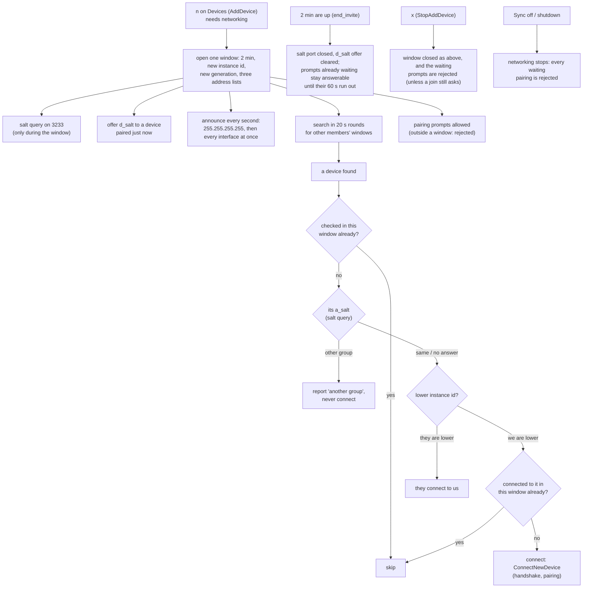
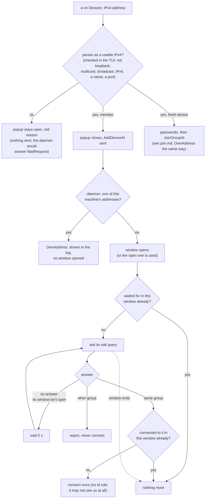
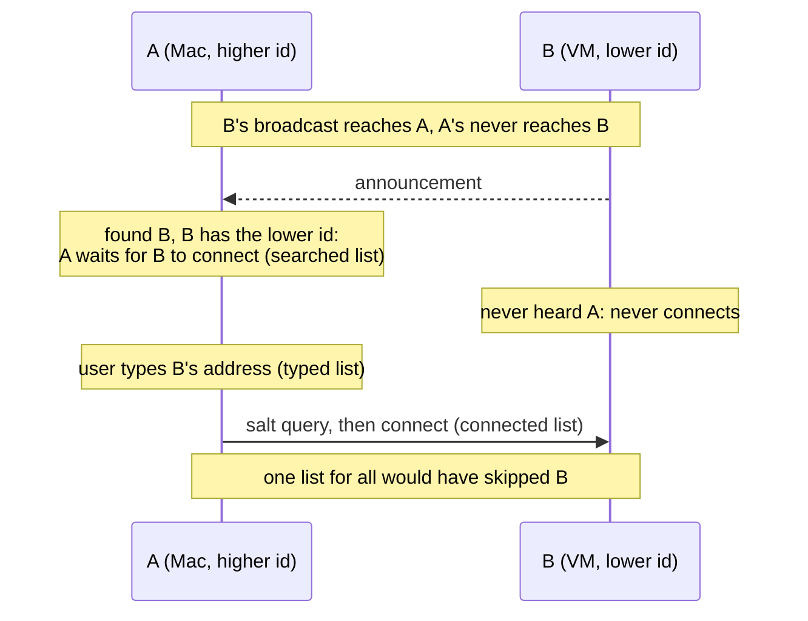

# The "Add device" window

daemon.md 9.1, 13 and 13.2. Outgoing connections to new devices happen only
in this window (2 min), never on every announcement.

## A typed address (`a`, 13.2)

For a device discovery can't reach: another subnet, a VPN.

## Why three lists

