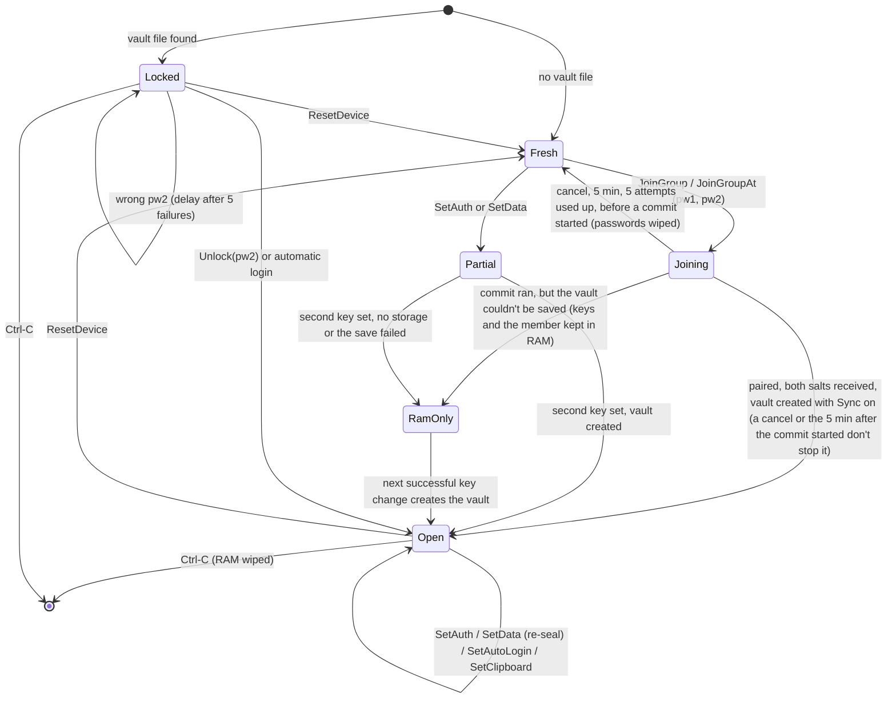
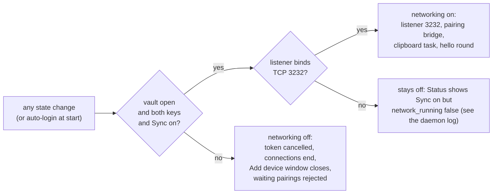
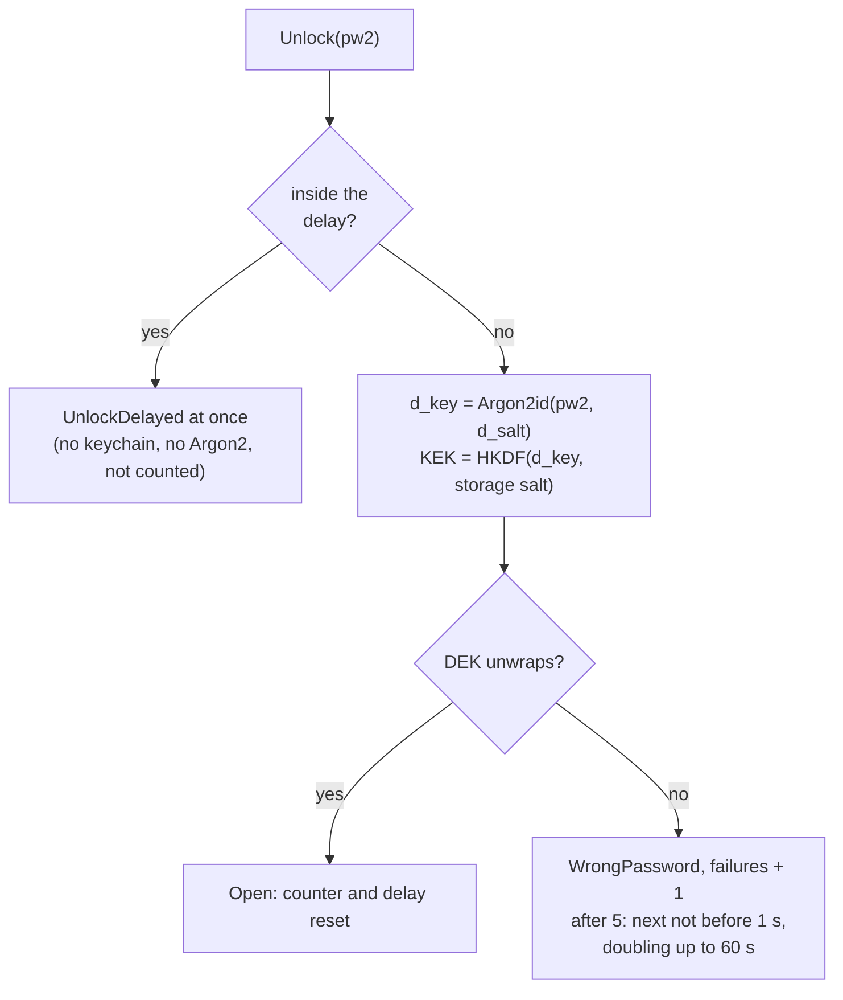

# Daemon states

daemon.md 6.1 and 13. Networking is not a state of its own: it runs exactly
while the vault is open, both keys are set and Sync is on, and every state
change checks that again.

## When networking runs

## Unlock delay

