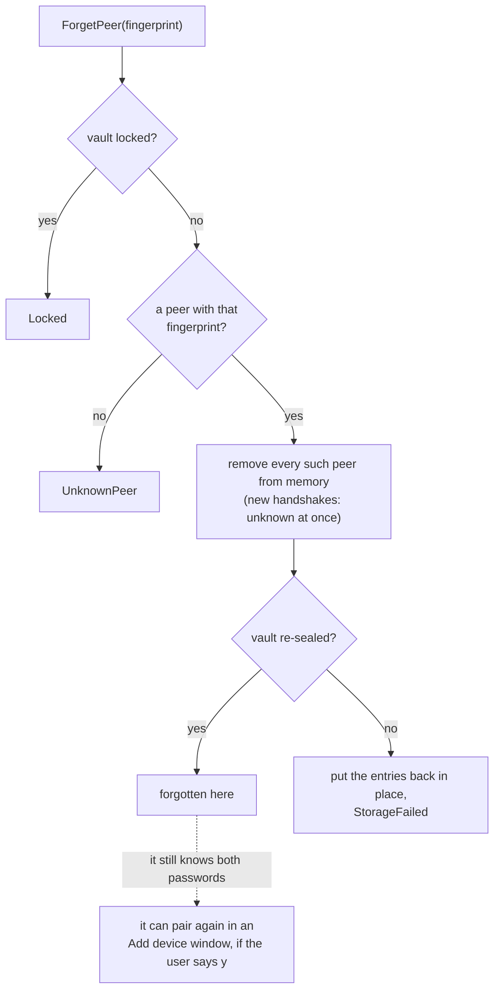
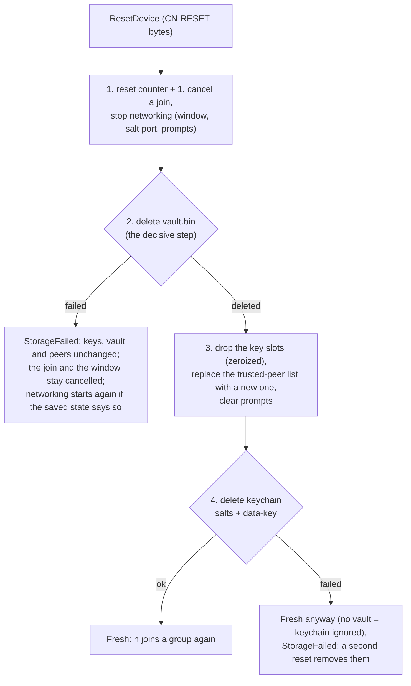
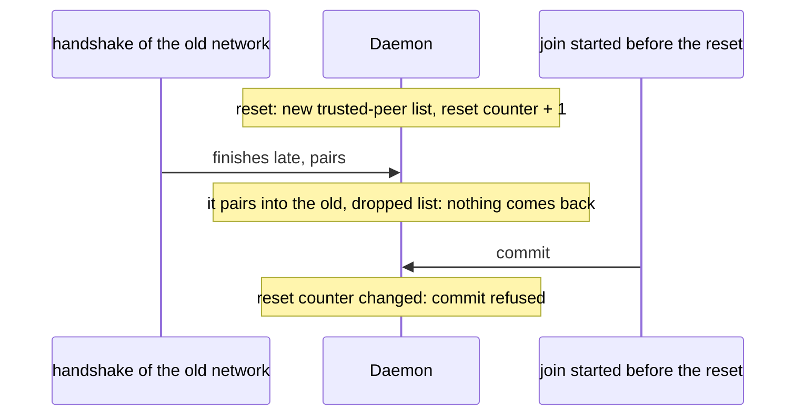

# Forgetting a device, resetting this one

daemon.md 14. Both are local: neither is a revocation.

## Forget (`d`, then `y`)

## Reset (Settings > Reset this device, type `RESET`)

Works while locked and asks for no password (a forgotten pw2 or lost
keychain salts are the reason to use it).

