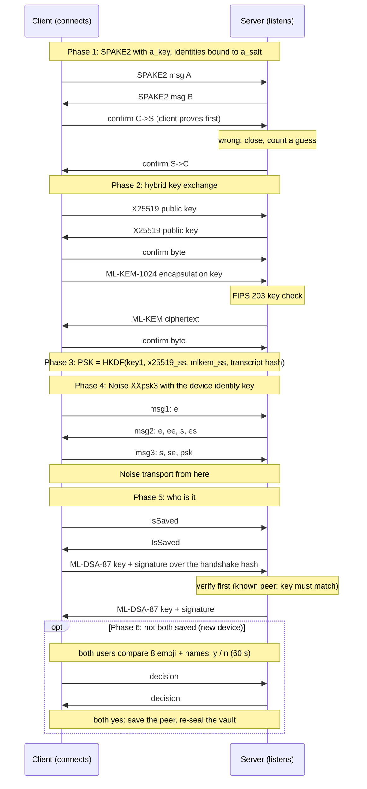
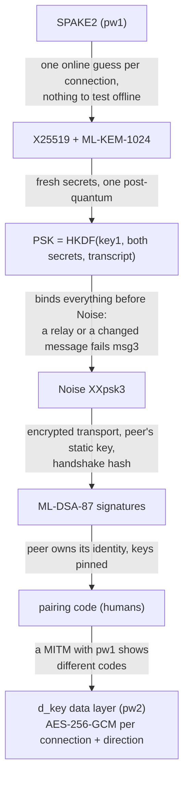
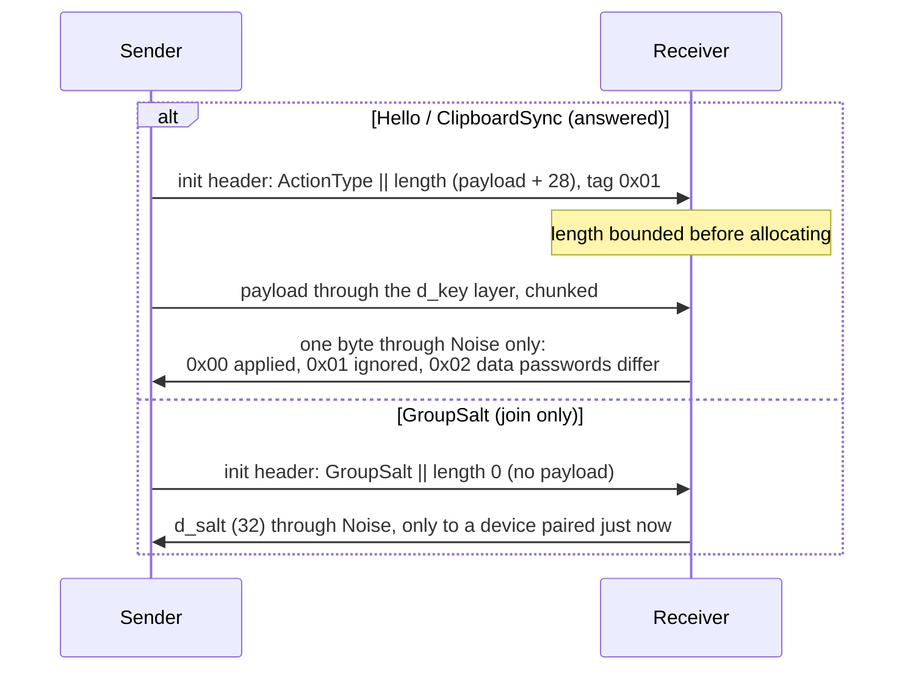

# auth_snow: the handshake

daemon.md 10. Phases 1-5 run under one 20 s deadline; pairing (6) waits for
humans, after the signatures verified.

## Why each layer

## One data packet (after the handshake)

