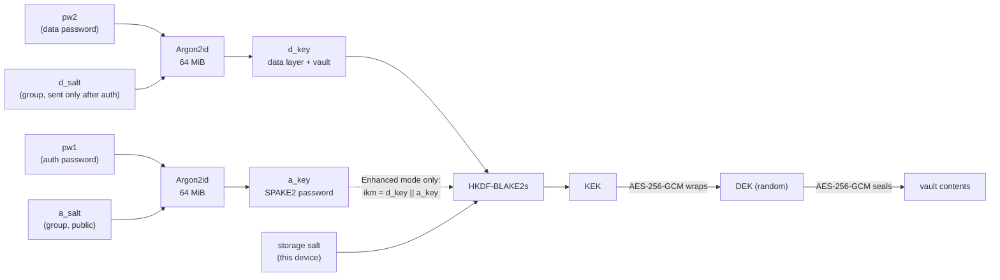
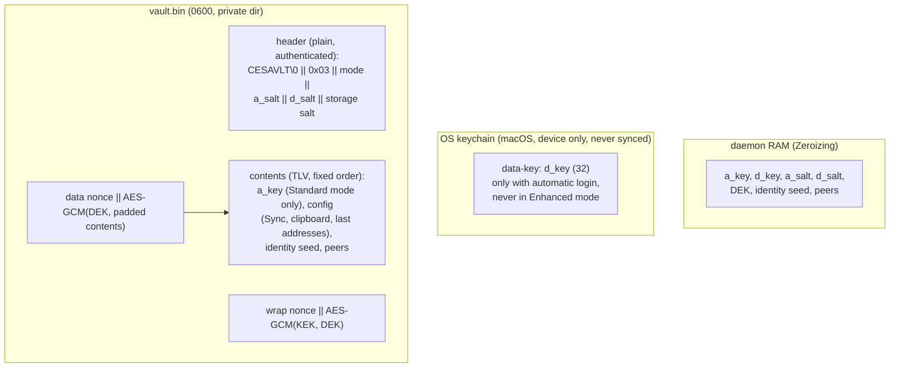
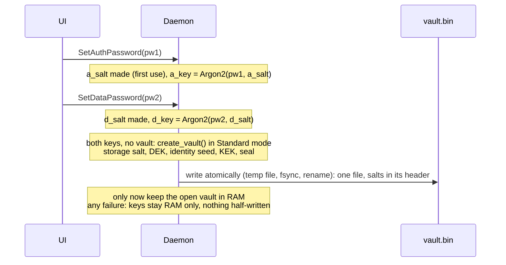
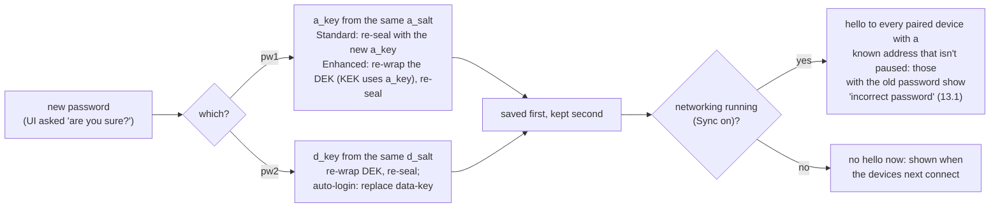
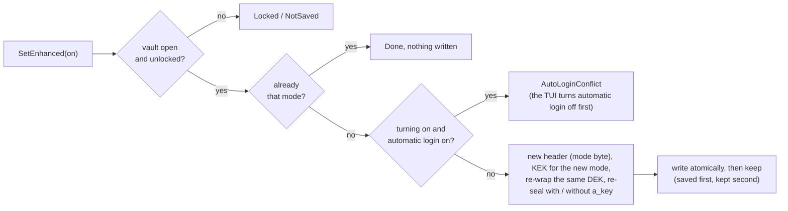

# Keys and storage

daemon.md 4, 6.3-6.7 and 8. Two passwords, two independent keys; the salts
belong to the group (section 11) and sit in the vault's header in plain.
The vault needs nothing from the OS; the keychain only holds `d_key` for
the opt-in automatic login.

Standard mode: `KEK = HKDF(d_key, storage salt, "cesaconn-storage-v1")`.
Enhanced mode: `KEK = HKDF(d_key || a_key, storage salt,
"cesaconn-storage-both-v1")`, so only both passwords together open it.

## What is stored where

The file alone is enough for an offline guess (its salts are in it), at a
full Argon2 run per guess: that is why new passwords need 12 characters.
Standard mode: cracking `pw2` also gives `a_key` (it is inside, 18.2).
Enhanced mode: `a_key` isn't in the file and a guess must get both
passwords right at once.

## First setup: creating the vault

## Changing a password

## Enhanced security on / off

