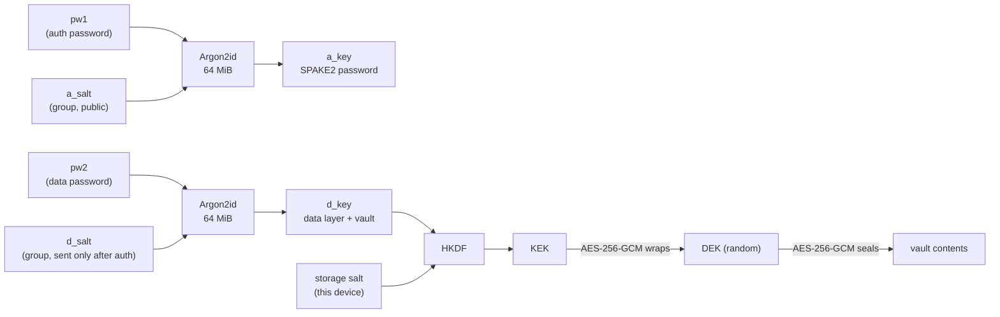
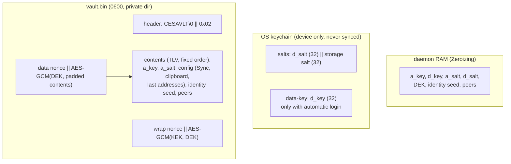
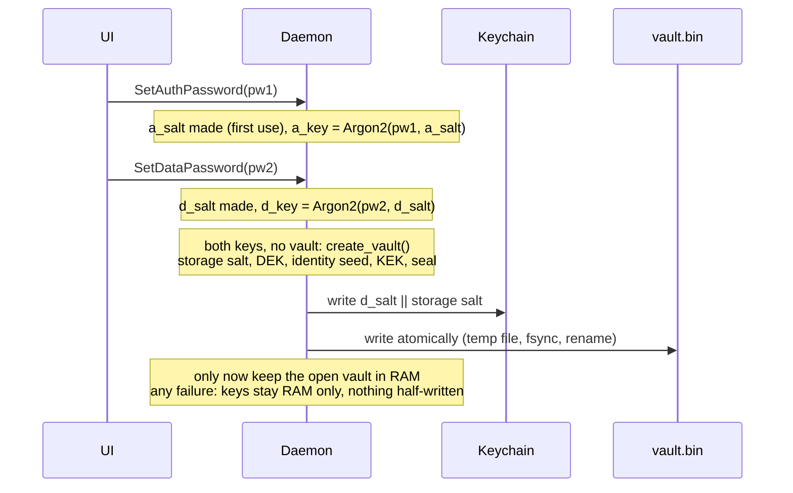
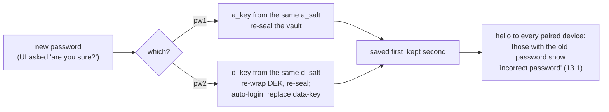

# Keys and storage

daemon.md 4, 6.3-6.5 and 8. Two passwords, two independent keys; the salts
belong to the group (section 11).

## What is stored where

Cracking `pw2` needs the vault file **and** the keychain salts; it then also
gives `a_key` (18). That is why new passwords need 12 characters.

## First setup: creating the vault

## Changing a password

