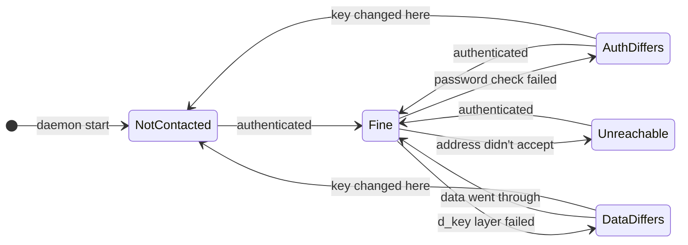
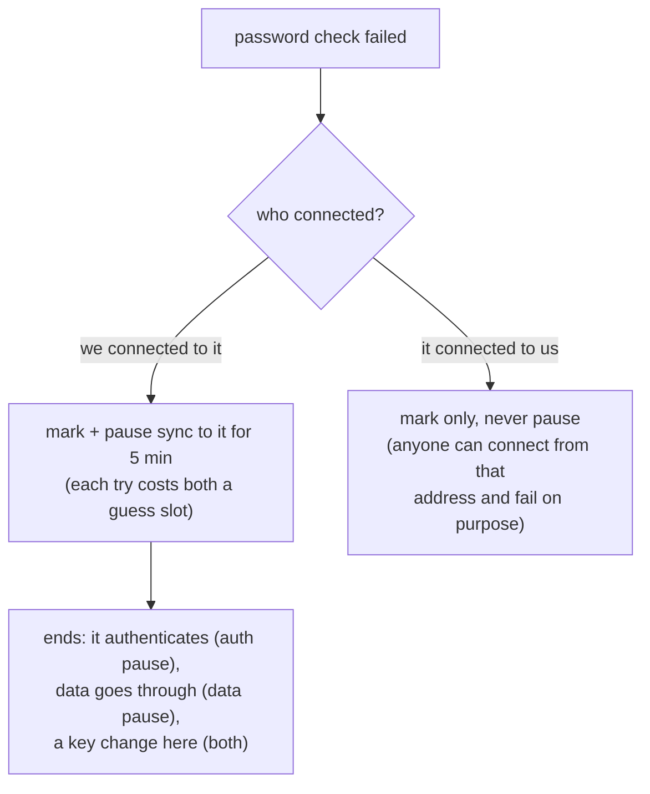
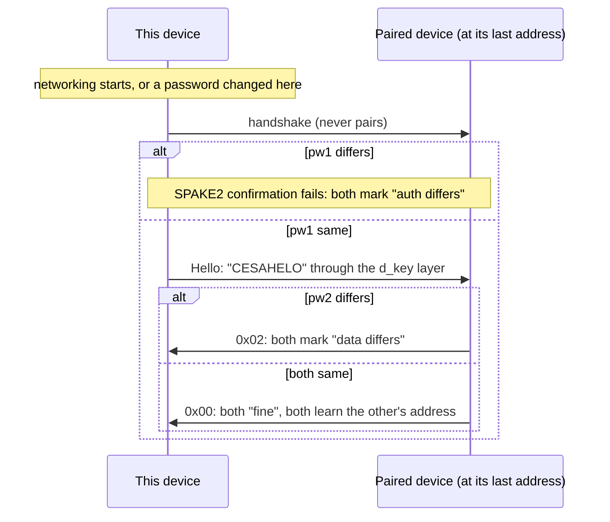

# A paired device's state

daemon.md 13.1. What the last connection with a paired device showed; a hint
for the user, the handshake still decides trust.

The main path only. From **any** state:

| Event | New state |
|---|---|
| the password check failed on a connection from or to its last address | auth differs |
| its last address didn't accept the connection | not reachable |
| a connection authenticated | fine, **except** from "data differs": that one needs data to go through |
| a key changed on this device | "auth differs" and "data differs" go back to not contacted (the next hello asks again); the others stay |

| State on the wire | TUI |
|---|---|
| `0x00` not contacted | grey |
| `0x01` fine | green |
| `0x02` auth password differs | "incorrect password (auth password differs)" |
| `0x03` data password differs | "incorrect password (data password differs)" |
| `0x04` not reachable | not reachable at its last address |

## The pause

## The hello

Addresses come only from authenticated connections: the address we
connected to, or the source IP of a paired device that authenticated to us
(port 3232). They are saved in the vault config, so sync finds the devices
after a restart.
